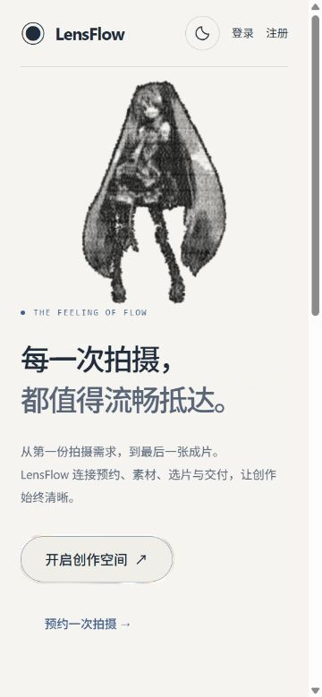

# LensFlow DS-01 · 跨平台设计系统提取与交接

本包向Huawei CodeArts交付当前LensFlow Web的可追溯视觉规格，用于独立开发原生微信小程序。审计开始于2026-10-18，交付完成于2026-10-19（Asia/Shanghai）。只完成DS-01，没有重新设计或修改Web，没有编写小程序，没有启动P3-D3或P4-A。

当前设计事实来源为分支 `design-system` 的活动工作区，基础HEAD `ea7cec43d297d6602f95b33b5c917d622c4b458f`。工作区含任务开始前的大量未提交改动，审计期间另一工作流仍在更新。不存在可确认的单一设计系统版本号；本包以日期、来源行、SHA-256和证据状态定位，不把应用`0.0.0`或历史Phase编号当权威设计版本。

## 先理解的设计结论

- 基础操作蓝`#007AFF`与品牌蓝灰`#6B7A99`仍在，但当前应用全局采用Material深浅主题：浅色暖白、深色石墨蓝灰；普通主按钮是中性底色、1px描边、胶囊圆角。只照旧蓝色字典无法复刻当前产品。
- 品牌／业务／摄影三类场景分别处理：品牌保留摄影与图文构图，业务保留清晰分组和下一动作，照片周边保留`#323232`中性灰、完整比例、无滤镜和阴影。
- 客户Web选片当前只有编号卡片，交付当前为文件信息和下载。小程序图片网格、大图交付、触屏预览与失效状态是明确标注的适配建议，不伪称Web已存在。
- 粒子肖像仅提取美术意图。不包含或建议移植Three.js、WebGL、GLSL、粒子数据、滚动变形或重动画替代实现；不修改、生成或重新分发品牌／客户照片。

## 阅读与使用顺序

| 文件 | 用途 |
|---|---|
| [01-source-audit.md](01-source-audit.md) | 活动入口、19类来源库存、历史文档权威与保护边界 |
| [02-visual-principles.md](02-visual-principles.md) | 品牌／业务／摄影场景、具体视觉原则与反例 |
| [03-token-reference.md](03-token-reference.md) | 基础值、当前Material生效值、局部指标和独立移动建议 |
| [04-component-specification.md](04-component-specification.md) | 20类组件／模式规格和九种状态矩阵；Tabs为明确缺口 |
| [05-mobile-screen-guidelines.md](05-mobile-screen-guidelines.md) | 首页、订单、我的、预约、订单详情、客户选片、预览、交付八页 |
| [06-platform-mapping.md](06-platform-mapping.md) | 原生导航、WXML/WXSS、触摸、px/rpx、安全区与文件动作 |
| [07-reference-index.md](07-reference-index.md) | 14张真实参考、来源、主题、CSS视口与JPEG差异、隔离方法 |
| [08-design-drift.md](08-design-drift.md) | 18项场景差异／真实不一致／历史遗留／未决问题 |
| [09-codearts-integration-guide.md](09-codearts-integration-guide.md) | CodeArts接入规则、必须匹配／可变／禁止、资产与责任表 |
| [10-acceptance-checklist.md](10-acceptance-checklist.md) | 24项原生验收要求与10项交付材料核验要求 |
| [tokens/lensflow-design-tokens.json](tokens/lensflow-design-tokens.json) | 不依赖React的机器可读字典；含逐条值、单位、含义、行号、原文、哈希与证据 |

直接交付 [CodeArts压缩包](lensflow-ds-01-codearts.zip) 即可，或复制本目录的文档、tokens、references、evidence与tools。压缩包排除 `.preview-cache/` 和压缩包自身，解压后从 `ds-01/README.md` 开始。JSON无需导入LensFlow代码；小程序必须维护自己的语义字典、组件和资源，不能建立跨仓库运行依赖。

## 事实、历史、建议与缺口

| 层次 | 数量／范围 | 解释 |
|---|---|---|
| VERIFIED_SOURCE | 306条：271条CSS变量声明＋35个组件局部指标 | 含别名和深浅主题覆写，不是306种独立颜色；每条都有真实源码与哈希 |
| VERIFIED_RENDER | 14张实际浏览器截图＋2份computed style记录 | 只确认对应画面／属性，不能给全部令牌自动升级渲染证据 |
| DOCUMENTED_ONLY | 旧Phase1–5、Material推广、既有响应式／性能／读屏报告 | 保留历史事实，不据此宣称本轮业务链／实机／全站验收通过 |
| PROPOSED_ADAPTATION | 30个独立移动token＋八页结构与平台建议 | 不覆盖Web值；所有精确移动尺寸均为建议 |
| UNRESOLVED | JSON中4个null＋接入指南责任表 | 最低基础库、设备导航高度、正式静态品牌资产、预约库存／价款等不捏造 |

组件规格覆盖19类实际实现或组合模式，另将共享Tabs缺失作为第20类显式记录。基本组件库、自定义Material选择器、局部图片CSS共同构成当前系统；不能误认成Ant Design或MUI默认主题。

## 视觉参考

下面的移动首页是现有Web在375×812 CSS视口下的真实画面，并非小程序设计稿；工具返回JPEG为360×779。桌面图有可见区域截断，详细限制及全部14张链接见 [07](07-reference-index.md)。



## 核验与仓库保护

最新机器结果：[交付验证](evidence/validation-results.json)、[静态配色](evidence/contrast-results.json)、[截图指纹](evidence/reference-captures.json)、[相关来源指纹](evidence/source-snapshot.json)、[开工基线](evidence/repository-baseline.json)、[结束比较](evidence/repository-verification.json)。

文档核验包括：必需文件齐全、JSON解析、token字段／别名／建议依据、真实来源路径／行号／原文／哈希、文档链接、JPEG有效性及14张图片指纹、静态配色与敏感模式扫描。截图均经实际查看；未运行后端pytest、迁移、生产构建或微信实机测试。22组当前主题不透明文字配对与2组基础色参考均保留真实计算结果，不能视为全站无障碍认证。

本任务所有有意写入均位于 `docs/design-handoff/ds-01/`，隔离预览配置、缓存和证据也在其中；没有切换分支、reset/clean、提交、修改生产源码／原图、操作数据库或改动LensFlow-WeChat。临时浏览器页和本次预览进程已停止。

初始保护集为1,011个Git跟踪／未忽略文件。审计期间发现并发更新，HEAD也被其他操作推进，因此全仓库开始／结束逐字节比较不是通过；`repository-verification.json`如实保留开始／结束HEAD、状态和变化清单，未为“通过”而回退其他工作。本任务未执行提交；其他流程提交已包含部分DS-01中间产物，最终补全及截图格式更名仍以当前文件和压缩包为准。306个token的直接来源仍单独按当前文件哈希与原文核验，二者不可混为一项。保护比较不对文件作者归因，也不覆盖忽略目录或数据库字节。

在仓库根目录复核（脚本只写DS-01证据）：

```powershell
node docs/design-handoff/ds-01/tools/repository-guard.mjs verify
node docs/design-handoff/ds-01/tools/verify-handoff.mjs
```

第一条若因并发变化退出非零，应阅读清单并保留，不得重建或覆盖开工基线。令牌需按后续Web变化重新审计时再运行提取脚本；本包当前来源哈希失配应报告漂移，不能静默改值。

## CodeArts实施前需确认

正式静态品牌资产与分发许可；目标基础库／主题策略；客户缩略图、预览与交付资源的当前安全契约；真实排期／时段／价格；客户状态中文与下一动作；iOS/Android触屏、文字放大、读屏、低内存与资源失效的实机结果。责任和确认前的回退方式已写入 [09](09-codearts-integration-guide.md)，可独立继续原生实现，无需反复猜Web样式。
