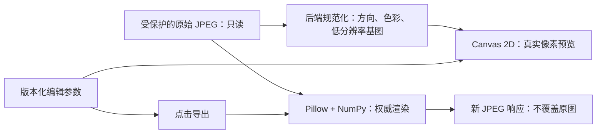

# LensFlow 图像处理核心：第一阶段代码审计与实施设计

- 编制日期：2026-10-17
- 项目：LensFlow 摄影工作流平台
- 状态：**方案待确认，尚未实施**
- 依据：本次对仓库源码、配置与本地 SQLite 的只读审计
- 适用范围：真实照片预览、基础修图、编辑参数管理和 JPEG 导出

> 本文保存此前审计报告与实施方案。数据库数量、迁移版本及环境配置描述是审计时的快照，不代表之后运行环境的实时状态。
>
> 审计仅进行了文件读取、静态分析和 SQLite 只读查询，没有执行测试、构建、迁移或依赖安装。本次依用户要求新增此 Markdown 文档，不代表授权实施后续代码改动。本文所列测试均为实施后的验证计划，不是已经通过的结果。

## 简明结论

现有架构可以增量承载图像处理核心，建议采用：

**前端 Canvas 2D 低分辨率预览 + 后端 Pillow/NumPy 权威渲染 + 版本化编辑参数。**

第一阶段不需要 Redis、Celery、RAW 解码库或新的任务表。但应先处理以下事实与边界：

1. 仓库已有 OpenCV 清晰度、亮度、高光和阴影分析，以及照片上传、外部修图版本上传、交付下载。尚未发现参数化修图、真实照片编辑预览、编辑参数保存或基于参数的 JPEG 导出。
2. 部分媒体接口只有角色校验，没有完整校验照片所属订单与当前用户的关系。
3. `Storage.get_path()` 在本地返回文件路径，在 OBS 返回 URL，而分析和下载代码仍按本地路径使用。
4. 部分后端测试会对配置中的数据库执行建表、删表；审计时本地 SQLite 还停留在初始迁移。
5. 第一阶段应先打通一张真实 JPEG 的完整闭环，服务端草稿持久化、多照片和修图交付整合分阶段推进。

---

## A. 现状报告

### A1. 实际技术栈

| 项目 | 当前代码事实 | 依据 |
|---|---|---|
| 前端 | React 19、TypeScript 6、Vite 8、React Router 7 | [frontend/package.json](../frontend/package.json) |
| 服务端状态 | TanStack Query 5 | [App.tsx](../frontend/src/App.tsx) |
| 客户端状态 | Zustand 5，当前主要用于认证和 Toast | [认证 Store](../frontend/src/stores/auth.ts) |
| HTTP | Axios，Bearer 请求拦截，默认超时 30 秒 | [client.ts](../frontend/src/api/client.ts) |
| UI | Tailwind CSS 4、自建 UI、MaterialScope、语义令牌；依赖中仍有 Ant Design | [UI 导出入口](../frontend/src/components/ui/index.ts)、[设计系统](design-system.md) |
| 后端 | FastAPI、Pydantic 2、SQLAlchemy 2、Alembic | [pyproject.toml](../backend/pyproject.toml) |
| 数据库访问 | 同步 SQLAlchemy Engine/Session，不是异步 ORM 会话 | [database.py](../backend/app/core/database.py) |
| 认证 | JWT HS256、python-jose、Passlib/bcrypt；服务端查询用户启用状态 | [security.py](../backend/app/core/security.py)、[deps.py](../backend/app/deps.py) |
| 图像依赖 | 已声明 OpenCV、NumPy、Pillow | [pyproject.toml](../backend/pyproject.toml) |
| 本地配置 | SQLite、本地文件存储 | `backend/.env` 的非敏感配置项；[config.py](../backend/app/core/config.py) |
| Compose 部署 | PostgreSQL 16、本地持久卷存储、Nginx 前端 | [docker-compose.yml](../docker-compose.yml) |
| 华为 OBS | 有实现骨架，尚不能据此认定生产可用 | [storage.py](../backend/app/services/storage.py) |

需要区分规划文档与实际代码：

- [dev-plan.md](dev-plan.md) 中 React 18、Vite 5、React Router 6 等属于早期规划；本方案以当前配置与源码为准。
- 后端依赖多数使用最低版本范围，不能将这些范围当作实际生产安装版本。
- README 中的华为云部署是项目方向；本轮没有验证云端实例、OBS Bucket 或生产 PostgreSQL。

### A2. 前端模块与可复用组件

#### 路由与页面

[App.tsx](../frontend/src/App.tsx) 已有：

- `/orders/:id/upload`
- `/orders/:id/analysis`
- `/orders/:id/retouch`
- `/orders/:id/selection`
- `/orders/:id/delivery`

当前页面能力：

| 页面 | 已有能力 | 图像核心缺口 |
|---|---|---|
| [UploadPage](../frontend/src/pages/photographer/UploadPage.tsx) | 上传文件、显示文件名/尺寸/大小、删除入口 | 没有照片画面预览 |
| [AnalysisResultPage](../frontend/src/pages/photographer/AnalysisResultPage.tsx) | 显示质量指标及人工复核 | 没有像素编辑 |
| [RetouchPage](../frontend/src/pages/photographer/RetouchPage.tsx) | 上传外部修图预览、客户反馈与确认 | 不是在线修图器；版本列表主要显示存储 key |
| [SelectionPage](../frontend/src/pages/client/SelectionPage.tsx) | 选择照片 ID 并提交 | 卡片尚无真实缩略图 |
| [DeliveryPage](../frontend/src/pages/client/DeliveryPage.tsx) | 交付文件与认证下载 | 不具备参数化导出 |

首页人物粒子 Canvas/WebGL 属于品牌装饰实现，不适合作为照片编辑管线复用。

#### 可以复用

- `Layout`、`MaterialScope`、设计令牌。
- `Button`、`Input`、`Select`、`Modal`、`LoadingState`、`ErrorState`、Toast。
- Axios 认证客户端。
- TanStack Query 的元数据加载与请求状态。
- 已有认证 Blob 下载模式：[downloadDelivery](../frontend/src/api/deliveries.ts)。
- Blob 下载与 URL 释放工具：[saveBlob](../frontend/src/utils/download.ts)。

#### 需要新增

- 单照片编辑入口和 Canvas。
- 低分辨率预览像素算法。
- 编辑参数状态、恢复、失效和冲突处理。
- 图片 Blob 加载、过时请求取消及资源释放。
- 裁剪交互与参数到像素坐标的转换。
- 导出 API 封装。

照片视口应避开装饰叠加。[useCardCursorGlow](../frontend/src/components/effects/useCardCursorGlow.ts) 会匹配 `.rounded-card` 等容器，新照片区域不能因复用样式而叠上影响图像判断的光晕。

### A3. 后端入口、服务与异常

[main.py](../backend/app/main.py) 将认证、预约、订单、照片、选片、修图和交付等路由统一挂在 `/api/v1` 下。

可复用：

- `get_current_user()`、`require_role()`。
- `get_db()`。
- `AppException` 与已有异常分类。
- `Storage` 抽象的总体方向。
- `OrderStateMachine` 与现有业务对象。

目前自定义业务异常采用统一格式，但 FastAPI 默认参数校验异常和 HTTP 异常并没有全部统一为同一种响应。依据：[异常定义](../backend/app/core/exceptions.py)、[异常注册](../backend/app/main.py)。

### A4. 数据模型和实际本地数据库

| 模型 | 当前作用 | 对图像核心的适用性 |
|---|---|---|
| `Photo` | 原文件引用、所属订单、MIME、大小、宽高 | 直接作为照片主引用 |
| `Order` | 客户、摄影师、订单状态 | 照片权限判断的归属根 |
| `AnalysisResult` | 清晰度、亮度等指标 | 继续用于分析，不能当编辑参数 |
| `SelectionSet/Item/Submission` | 选片集与提交 | 后续确定客户可见照片 |
| `RetouchTask` | 单张照片的修图协作任务 | 后续编辑器入口 |
| `RetouchVersion` | 上传的修图文件版本 | 可承接明确发布的渲染结果，不直接承载可变草稿 |
| `Delivery` | 最终交付文件 | 保留现有交付流程 |

依据：[Photo](../backend/app/models/photo.py)、[Order](../backend/app/models/order.py)、[AnalysisResult](../backend/app/models/analysis.py)、[选片模型](../backend/app/models/selection.py)、[修图模型](../backend/app/models/retouch.py)、[Delivery](../backend/app/models/delivery.py)。

现有模型没有编辑参数 JSON、编辑修订号、导出任务状态或渲染版本字段。

`Photo.order_id`、修图任务与版本的多数关联只是整数列和索引，没有数据库外键。对实际 SQLite 的只读 `foreign_key_list` 检查也确认了这一点，不能依赖数据库自动保证照片、任务和文件一致性。

#### 审计时本地数据库快照

- 文件：`backend/storage_local/lensflow.db`。
- `alembic_version`：`5e0b2fd720d3`。
- 仓库已有后续迁移：`f3a1c2d4e5b6`。
- 当前 `bookings` 表缺少模型中的 `location`、`duration_hours`。
- `photos` 表为 0 条，配置的上传目录为 0 个文件。

依据：[后续迁移](../backend/alembic/versions/f3a1c2d4e5b6_add_booking_location_duration.py)、[Booking 模型](../backend/app/models/booking.py)。上述快照不代表其他验收目录或生产环境。

### A5. 上传、存储、访问与文件生命周期

#### 当前上传流程

[photos.py](../backend/app/api/v1/photos.py) 的 `upload_photo()`：

1. 接收 JPEG，限制 20 MiB。
2. 整体读入内存。
3. 调用 `storage.save()` 保存原始字节。
4. OpenCV 解码，读取宽高。
5. 创建 `Photo`。
6. 使用 FastAPI `BackgroundTasks` 执行质量分析。

原始上传字节没有被重编码，这一点可以保留。

#### 当前缺口

| 问题 | 源码事实与影响 |
|---|---|
| 对象归属校验不完整 | 照片上传、列表、删除、分析读取和复核未完整沿照片查询订单并核对当前用户 |
| 有效解码不是强制成功条件 | `cv2.imdecode()` 返回 `None` 后仍可能保存宽高为空的照片记录 |
| 先保存，再验证和提交 | 解码或数据库失败可能留下孤立文件 |
| 只有压缩文件字节限制 | 未见解码像素数和处理内存限制 |
| 缺少照片图片读取接口 | `storage_key` 不是可以直接用于认证预览的图片资源 |
| 删除关联不完整 | 删除原图和分析结果后可能留下选片、修图引用 |
| 分析依赖本地路径 | `_run_analysis()` 对 `get_path()` 结果直接 `open()` |

[LocalStorage](../backend/app/services/storage.py) 使用 UUID 文件名，可复用，但缺少专门只读接口、原图/衍生文件区分以及路径边界校验。

OBS 目前存在：

- `get_path()` 返回 URL，但 `_run_analysis()` 按本地路径打开。
- 交付下载把该返回值传给 `FileResponse`。
- `obs` SDK 没有在当前 `pyproject.toml` 中声明。
- 上传没有完整检查对象存储响应是否成功。

所以第一阶段只验收当前本地存储，OBS 另设适配任务。现有交付下载的归属校验可以借鉴：[download_delivery()](../backend/app/api/v1/deliveries.py)。

### A6. 测试、依赖和部署

- 后端：pytest、pytest-asyncio、FastAPI TestClient、HTTPX。
- 前端：Vitest、Testing Library、jsdom。
- 图像分析测试主要用 NumPy/OpenCV 生成测试图，不等于真实摄影 JPEG 端到端验收。
- `test:ui` 只覆盖指定 UI 组件，不能代表全部前端测试。
- 文档提及 Playwright，但当前前端依赖没有声明它，不能把浏览器像素测试视为已有能力。

#### 测试隔离风险

[test_photos.py](../backend/tests/test_photos.py) 的 fixture 对导入的配置 `engine` 执行 `create_all/drop_all`。仅覆盖 `get_db()` 也不够，因为上传后台分析直接使用模块中的 `SessionLocal`。

后续测试必须同时隔离：

- 测试数据库。
- 文件上传目录。
- 后台任务的会话工厂。
- 通知发送。

[隔离验收启动脚本](../backend/scripts/run_design_system_acceptance.py) 的环境隔离方式可参考，但不能当作本次图像核心测试已通过的证据。

#### 构建与部署核查

- [Nginx](../frontend/nginx.conf) 已代理 `/api/`，读取超时 120 秒。
- Axios 默认超时 30 秒，导出请求需要单独协调。
- 前端 `.env` 使用 `http://localhost:8000`，Vite 会把地址带入构建；生产必须核对实际构建配置。
- 前端 Docker 使用 pnpm lock，但仓库同时存在 npm lock，需要明确后续依赖安装依据。
- 后端 Docker 依赖安装与 `pyproject.toml` 不完全一致。
- 实际云镜像、部署服务和资源规格尚未确认。

现有命令定义参见 [README](../README.md)、[Makefile](../Makefile)、[前端 package.json](../frontend/package.json)、[后端 Dockerfile](../backend/Dockerfile)、[前端 Dockerfile](../frontend/Dockerfile)。这些命令本轮没有执行。

#### 额外认证发现

公开注册接口直接保存请求中的 `role`，而请求类型包含 `admin`。这是需要修复的静态审计发现，新图像接口不应增加默认管理员绕过。依据：[认证请求模型](../backend/app/schemas/auth.py)、[角色定义](../backend/app/types.py)、[注册实现](../backend/app/api/v1/auth.py)。本轮未发送请求验证此行为。

---

## B. 推荐架构

### B1. 最小闭环



### B2. 前端预览与交互

1. 通过认证 Axios 获取照片信息和预览 Blob。
2. 后端基图统一方向与输入色彩，前端不拼接存储 URL。
3. Canvas 保留未编辑基图，每次从基图重新计算，不能在上次结果上反复累加。
4. 使用 `ImageData` 做曝光、色彩等真实像素运算。
5. 参数存入编辑状态，大像素缓冲保留在组件引用或专用渲染对象中，不塞入普通业务 Store/Query 缓存。
6. 拖动时合并连续事件，只处理最新参数；可采用长边 512px 的交互预览，松手后更新到 1024px。
7. 取消过时请求，切图和退出时释放 Blob URL、位图、像素缓冲。

不以 CSS `filter` 代替修图，不复用首页粒子 renderer。照片视口保持中性背景，控件继续复用现有设计系统。

### B3. 后端读取、处理和输出

拆为三类职责：

- **访问服务**：沿 `photo_id → Photo → Order` 校验归属。
- **规范化解码服务**：验证格式、尺寸、方向、色彩和原图指纹。
- **纯图像处理服务**：输入像素与参数，输出新图像，不依赖 HTTP、订单状态或通知。

第一阶段点击导出后同步处理一张 JPEG。CPU 工作放在同步处理路径或受控执行环境，不直接塞进异步上传函数阻塞事件循环。

FastAPI `BackgroundTasks` 不作为可靠导出队列。现有质量分析继续存在；只有后续确有长任务、重试、跨进程恢复需求时，才设计持久任务记录和执行器。

### B4. 原图只读和资源生命周期

- 原图引用只来自数据库，客户端不能提交任意路径、URL 或 `storage_key`。
- 增加明确的 `Storage.open_read()` 类接口，不混用本地路径和对象 URL。
- 编辑服务不调用覆盖原文件的方法。
- 预览、缓存、导出使用独立命名空间或临时文件。
- 首版导出直接返回 JPEG，不自动登记为 `Delivery`。
- 较大输出可使用可溢写到磁盘的临时文件，响应完成或连接中断后关闭清理。
- 编辑前后原图 SHA-256 一致，作为验收条件。
- 用户显式删除原图是独立生命周期操作，需要权限和引用检查，不由预览、修图或导出触发。

### B5. 编辑状态保存与恢复

#### 第一阶段：不改数据库

- 内存参数状态。
- 本浏览器、本用户的本地草稿。
- 草稿键至少包含 `user_id + photo_id + source_version + schema_version`。
- 刷新恢复、重置、来源失效提示。
- 退出登录清理图片缓存和编辑状态。

界面明确标注为本地草稿，不能宣称已保存到服务器。

#### 第二阶段：最小数据库改动建议

优先扩展现有 `Photo`，不先创建新表：

- `edit_state`：SQLAlchemy 通用 JSON，可空。
- `edit_revision`：整数，默认 0。

状态内部保存 schema/render 版本和来源指纹。并发保存使用修订号条件更新，不做简单的先读后写。

`RetouchVersion` 仍代表发布文件版本，不把当前可变草稿和客户可见版本混用。上述仅是建议，本轮没有新增字段或迁移。

### B6. 权限、异常、容量与滑块请求策略

首版只开放给照片所属订单的摄影师：

- 客户不直接访问原片、编辑草稿和内部导出接口。
- 后续客户预览通过已发布选片或修图版本授权。
- 建议已取消、已归档订单只读；具体写入策略实施前确认。
- 预览、保存参数、导出不自动推进订单状态。

输入防护：

- 校验真实 JPEG 解码，不只相信扩展名和 MIME。
- 限制字节数、像素数、边长、参数和导出并发。
- 拒绝 NaN、Infinity、非法裁剪、未知版本。
- 异常不泄漏路径、堆栈或敏感配置。
- 导出失败不覆盖原图，不生成错误的已交付状态。

滑块事件仅触发前端低分辨率计算；后端导出仅由用户显式点击触发。后端权威预览用于显式核对，不绑定每次滑块变化。

---

## C. 数据结构与 API 草案

> 本节全部为拟议接口，不能视为当前已经实现的 API。

### C1. 统一编辑参数

建议新增 `contracts/image-edit-v1.json`，作为字段、默认值、范围和处理顺序的唯一来源。Python 与 TypeScript 消费或生成适配定义，以共享测试样例验证一致性。

分别管理：

- `schema_version`：参数结构版本。
- `render_version`：算法语义版本。算法变化需显式升级，旧草稿不能静默套用新算法。

```json
{
  "schema_version": 1,
  "render_version": "basic-srgb-v1",
  "exposure_ev": 0,
  "contrast": 0,
  "saturation": 100,
  "temperature": 0,
  "rotation_deg": 0,
  "crop": { "x": 0, "y": 0, "width": 1, "height": 1 }
}
```

| 参数 | 范围 | 默认值 | 单位与语义 |
|---|---|---|---|
| 曝光 | `[-4,4]` | `0` | EV，在线性 RGB 中乘 `2^EV` |
| 对比度 | `[-100,100]` | `0` | 相对刻度，`k=2^(contrast/100)`，使用 `0.5+k×(v-0.5)` |
| 饱和度 | `[0,200]` | `100` | 百分比；0 灰阶、100 原饱和度、200 两倍 |
| 色温 | `[-100,100]` | `0` | 相对冷暖刻度，正值偏暖，不是 Kelvin |
| 旋转 | `0/90/180/270` | `0` | 顺时针度数，首版仅直角旋转 |
| 裁剪 x/y | `[0,1)` | `0/0` | 相对旋转后图像的左上角 |
| 裁剪宽/高 | `(0,1]` | `1/1` | 相对旋转后图像宽高 |

#### 色温定义

首版采用可重复的近似：

```text
t = temperature / 100
R *= 2^(0.25t)
G 不变
B *= 2^(-0.25t)
```

这是工程上的冷暖调整，不是摄影 RAW 白平衡或物理色温恢复。

#### 饱和度定义

在线性 RGB 中：

```text
Y = 0.2126R + 0.7152G + 0.0722B
RGB' = Y + (saturation / 100) × (RGB - Y)
```

#### 固定处理顺序

1. 解码与文件验证。
2. 应用 EXIF 方向。
3. 输入规范化为约定的 sRGB。
4. 用户旋转。
5. 用户裁剪。
6. 预览分支缩小；原尺寸导出不缩小。
7. sRGB 转线性 RGB。
8. 曝光。
9. 色温。
10. 对比度。
11. 饱和度。
12. 最终裁切到合法颜色范围。
13. 转回 sRGB、量化。
14. 编码输出。

不在每一步提前裁掉高光，否则会额外增加差异。

EXIF 方向规范化属于基础显示正确性；完整 EXIF 保留策略仍留在后续阶段。

#### 裁剪校验

- `x + width ≤ 1`。
- `y + height ≤ 1`。
- 映射后的原图裁剪至少 `2×2` 像素。
- 左、上边界使用 `floor`；右、下边界使用 `ceil`。
- 参数精度、容差、规范化规则写进统一契约与共享样例。

### C2. 照片引用

```json
{
  "photo_id": 123,
  "order_id": 45,
  "source_version": "sha256:...",
  "normalized_width": 6000,
  "normalized_height": 4000,
  "working_color_space": "srgb",
  "render_version": "basic-srgb-v1"
}
```

`source_version` 来自原始文件字节，不使用 `Photo.updated_at`；保存草稿会更新该时间，它不代表原图变化。现有 OpenCV 宽高也不能未经核对就作为方向规范化后的编辑尺寸。

### C3. API 清单

所有路径均在 `/api/v1` 下。

| 阶段 | 方法与路径 | 输入 | 输出 | 鉴权 |
|---|---|---|---|---|
| 1，改造现有 | `POST /orders/{order_id}/photos` | JPEG multipart；保留 20 MiB 上限并增加真实解码、像素校验 | `201`，兼容 `PhotoUploadResponse` | 所属订单摄影师 |
| 1，新增 | `GET /photos/{photo_id}/image-info` | 路径 ID | 照片引用、规范化尺寸、支持能力、默认参数 | 所属订单摄影师 |
| 1，新增 | `GET /photos/{photo_id}/preview?max_side=1024` | `max_side` 限定为 `256/512/1024` | 方向、色彩规范化的未编辑 PNG 基图，附来源版本 | 所属订单摄影师 |
| 1，新增 | `POST /photos/{photo_id}/preview` | `source_version`、完整参数、`max_side` | 后端权威处理的低分辨率 PNG | 所属订单摄影师 |
| 1，新增 | `POST /photos/{photo_id}/exports` | 来源版本、参数快照、输出选项 | `200 image/jpeg`，直接下载并附结果头信息 | 所属订单摄影师 |
| 2，新增 | `GET /photos/{photo_id}/edit-state` | 路径 ID | 服务端草稿、修订号；无草稿时返回默认参数和 revision 0 | 所属订单摄影师 |
| 2，新增 | `PUT /photos/{photo_id}/edit-state` | 参数、来源版本、`If-Match` 修订号 | 新修订号及规范化参数 | 所属订单摄影师 |

约定：

- GET 基图仅在打开照片或来源变化时获取。
- POST 预览用于显式核对，不跟随每次滑块变化。
- 缓存响应仍先鉴权，不公开原片存储路径。
- 预览、保存、导出不自动改变订单状态。

#### 导出请求

```json
{
  "source_version": "sha256:...",
  "edit": {
    "schema_version": 1,
    "render_version": "basic-srgb-v1",
    "exposure_ev": 0.5,
    "contrast": 10,
    "saturation": 105,
    "temperature": 8,
    "rotation_deg": 90,
    "crop": { "x": 0.1, "y": 0.05, "width": 0.8, "height": 0.9 }
  },
  "output": {
    "format": "jpeg",
    "quality": 90,
    "max_long_edge": null
  }
}
```

输出选项：

- `format` 首版固定为 `jpeg`。
- `quality` 整数 `[60,95]`，默认 90。
- `max_long_edge=null` 表示旋转裁剪后的原尺寸。
- 指定缩小边长时不放大原图。
- 色度采样方式固定在契约中，避免默认值差异。

#### 导出结果

首版直接返回二进制，不设计虚假任务 ID、进度轮询或尚不存在的下载 URL。

响应包含：

- `Content-Type: image/jpeg`
- `Content-Disposition`
- `X-Request-Id`
- `X-Source-Version`
- `X-Edit-Digest`
- `X-Render-Version`
- `X-Image-Width`、`X-Image-Height`

前端封装成 Blob、文件名、尺寸、来源版本、参数摘要，再复用 `saveBlob()`。

跨域时要配置响应头暴露；Axios Blob 错误响应需要先解析 JSON，不能直接交给现有字符串错误解析器。

### C4. 参数校验和错误响应

保持现有业务错误的主体格式：

```json
{
  "code": "INVALID_EDIT_PARAMS",
  "message": "编辑参数无效",
  "detail": "crop.x + crop.width must be <= 1"
}
```

| HTTP 状态 | 建议错误 |
|---|---|
| 401 | 未登录、令牌失效 |
| 403 | 角色或订单归属不允许 |
| 404 | 照片记录、原始文件不存在 |
| 409 | 原图指纹变化，编辑来源失效 |
| 412 / 428 | 服务端草稿修订冲突 / 缺少必要条件头 |
| 413 | 文件、像素、输出容量超预算 |
| 415 | 不支持的实际图像格式 |
| 422 | 参数非法、版本不支持、JPEG 损坏、不支持的色彩输入 |
| 429 | 导出容量已满，附 `Retry-After` |
| 500 / 503 | 处理失败、存储或处理能力不可用 |

需要为 FastAPI 参数校验与 HTTP 异常补充一致性适配，同时回归原接口错误解析兼容性。

---

## D. 分阶段实施计划

以下均为后续实施设计，本轮没有创建业务代码或数据库结构。

### 阶段 1：一张真实 JPEG 的最小闭环

- **目标**：由现有上传与 `Photo` 记录读取真实照片，完成预览、六类调整和 JPEG 下载。
- **文件范围**：统一参数契约；访问、只读存储、图像处理服务；信息/预览/导出接口；单照片页和 Canvas；本地参数恢复；隔离测试。具体路径见最后一节。
- **前置条件**：测试隔离；确认后处理本地迁移落后；一张授权真实 JPEG；像素与并发预算；对象归属校验。
- **验收标准**：调整真实像素；刷新恢复本地参数；导出 JPEG 可打开且尺寸/方向/裁剪正确；共享参数快照；原图哈希不变；无权限访问被拒绝；拖动不触发导出。
- **测试方式**：纯算法单测、隔离 HTTP 集成、真实浏览器和真实 JPEG 对照。
- **风险**：色彩差异、方向重复应用、内存峰值、裁剪坐标错误。

### 阶段 2：服务端草稿与并发保存

- **目标**：跨刷新、跨设备恢复，避免相互覆盖。
- **文件范围**：扩展 `Photo`；Alembic 迁移；编辑状态 schema 和 GET/PUT；前端同步及冲突界面。
- **前置条件**：阶段 1 闭环通过，契约稳定。
- **验收标准**：重新登录可恢复；同 revision 双端保存只有一个成功；冲突不静默覆盖本地草稿；导出固定使用点击时快照。
- **测试方式**：SQLite/PostgreSQL 条件更新、双会话并发、刷新恢复测试。
- **风险**：JSON 兼容、错误依赖时间戳、草稿与导出快照混淆。

### 阶段 3：多照片与性能

- **目标**：切图、有限缓存、取消过时处理、参数撤销重做。
- **文件范围**：状态、调度器、资源缓存、照片列表与入口、必要的预览缓存服务。
- **前置条件**：单张处理和草稿语义稳定。
- **验收标准**：不串图串参数；旧请求不覆盖新图；缓存有上限；退出释放；记录指定设备交互延迟、内存、导出耗时。
- **测试方式**：快速切图、连续拖动、长时间会话、取消与内存观察。
- **风险**：Blob/位图泄漏、过多高分辨率解码、主线程阻塞。

### 阶段 4：接入现有修图与交付

- **目标**：明确发布的编辑结果进入既有修图版本、确认与交付流程。
- **文件范围**：`RetouchPage`、修图 API、版本元数据或关联扩展、交付页、权限和清理服务。
- **前置条件**：参数快照可靠，现有业务链阻断项修复。
- **验收标准**：草稿不发布给客户；发布产生新文件；不覆盖原图与旧版本；客户只看授权版本；失败不推进为已交付。
- **测试方式**：摄影师、所属客户、其他客户的真实业务链。
- **风险**：现有 `count()+1` 版本分配存在并发风险；文件和事务失败不一致，需要事务分配与唯一性方案。

### 阶段 5：色彩、元数据和存储扩展

- **目标**：扩展 ICC、EXIF 保留、OBS、RAW 内嵌 JPEG 预览和可靠长任务。
- **文件范围**：解码/色彩模块、存储适配器、部署和专项测试。
- **前置条件**：真实样片、目标云环境、测量数据。
- **验收标准**：元数据/色彩可解释可验证；OBS 私有读取与鉴权正常；RAW 预览能力边界明确；确有长任务需求时才设计记录、恢复、重试。
- **测试方式**：真实色彩配置样片、EXIF 方向样片、OBS 集成、RAW 内嵌预览兼容矩阵及故障恢复测试。
- **风险**：新依赖、平台兼容、存储生命周期、ICC/EXIF 错误复制。

---

## E. 风险清单

| 风险 | 当前依据或原因 | 处理建议 |
|---|---|---|
| 预览与导出差异 | 两套语言、解码和重采样 | 统一契约/顺序/浮点规则、共享样例、后端权威预览 |
| 大图内存 | 完整读文件，浮点数组成本高 | 限制像素和并发，分块计算，避免每步整图复制 |
| EXIF 方向错误 | 缺少编辑坐标约定 | 只应用一次方向，后续几何操作基于规范化坐标 |
| ICC 误处理 | 声明 Pillow 不等于具备所有色彩能力 | 验证实际能力，不能转换时明确拒绝，不静默丢配置 |
| 元数据泄漏或过期 | 导出后方向、尺寸变化 | 首版不承诺完整保留，不复制过期方向/尺寸，不默认带 GPS |
| 状态丢失 | 无编辑状态模型 | 首版本地草稿，后续 revision，来源变化使旧草稿失效 |
| 并发覆盖 | 版本计数加一 | 草稿条件更新，发布版本事务分配及唯一性设计 |
| 导出失败或重复 | 超时、重试、资源不足 | 首版不自动重试导出，明确拒绝和清理，失败不改业务状态 |
| 原图与衍生混淆 | 当前 Storage 接口未区分 | 只读源与衍生输出分开，永不写回原 key |
| 权限越界 | 部分接口只校验角色 | 沿 Photo→Order 校验，原片与客户发布预览分开 |
| 数据库兼容 | 迁移落后，多数关联无外键 | 隔离验证迁移，服务层核对引用，约束逐项增加 |
| OBS 不兼容 | URL 当路径，SDK 未声明 | 首版本地，OBS 单独适配验收 |
| 测试破坏数据 | 配置 engine 上建表删表 | 先隔离，不能直接在当前环境运行全套后端测试 |
| UI 干扰照片 | 光晕覆盖预览区域 | 中性无装饰照片视口，控件复用设计系统 |

### 内存与容量起点

24MP 的 RGB `float32` 数组仅一份约 288MB，多份中间数组会迅速超过常见容器预算。像素上限不能代替内存设计。

首版建议以以下条件起步，再实测调整：

- 输入 20 MiB 上限。
- 暂定 24MP 像素上限。
- 单进程同时一个高分辨率导出。
- 配合分块浮点处理、临时输出和容量拒绝。

这是设计起点，不是已测得的安全容量。多 Uvicorn worker 时需乘以进程数重新预算。

### 尚未确认

- 实际生产数据库、云实例、容器内存和 CPU。
- OBS 是否在用、Bucket 权限、SDK 可用性。
- 实际后端安装版本、Pillow 编译功能和 ICC 支持。
- 首张真实摄影 JPEG 样片。
- 原片尺寸分布、典型批量、输出质量和元数据需求。
- 当前全部历史测试的实际通过情况。

---

## 第一阶段实施任务

> 下一步只推进一张真实 JPEG 的闭环，不提前扩展多照片或复杂工作流。实施需先得到用户确认。

### 1. 优先修改的现有文件

| 文件 | 修改目标 |
|---|---|
| [backend/tests/conftest.py](../backend/tests/conftest.py) 与相关 fixture | 隔离数据库、存储、后台会话和通知 |
| [storage.py](../backend/app/services/storage.py) | 只读读取、本地路径边界，保留现有接口兼容 |
| [photos.py](../backend/app/api/v1/photos.py) | 对象归属、真实 JPEG 校验、像素限制、失败清理 |
| [main.py](../backend/app/main.py) | 注册图像路由和异常适配 |
| [config.py](../backend/app/core/config.py) | 声明字节、像素、并发和输出预算 |
| [App.tsx](../frontend/src/App.tsx) | 单照片编辑路由 |
| [UploadPage.tsx](../frontend/src/pages/photographer/UploadPage.tsx) | 由真实照片进入编辑器 |
| [client.ts](../frontend/src/api/client.ts) 或新封装 | 认证 Blob、导出超时、Blob 错误解析 |

### 2. 拟新增文件

以下路径为计划，尚未创建：

```text
contracts/image-edit-v1.json
backend/app/schemas/image_edit.py
backend/app/services/image_access.py
backend/app/services/image_editor.py
backend/app/api/v1/image_edit.py
frontend/src/api/imageEdit.ts
frontend/src/image/editPipeline.ts
frontend/src/components/editor/PhotoCanvas.tsx
frontend/src/pages/photographer/PhotoEditorPage.tsx
```

并增加对应算法、接口与交互测试。第一阶段不新增数据库表，也不要求修改 `Photo` 表。

### 3. 第一张真实 JPEG 的验收步骤

1. 在隔离环境应用已有迁移，创建真实账户与所属订单，禁用对外通知。
2. 准备有使用授权、主体和色彩可辨认的真实摄影 JPEG，记录原始字节 SHA-256。
3. 由现有上传 API 上传，获得真实 `photo_id`，不使用硬编码演示数据代替。
4. 获取认证预览，在实际编辑页显示，核对方向、比例、颜色。
5. 分别调整曝光、对比度、饱和度、冷暖，再测试组合、旋转、裁剪。
6. 观察网络，拖动滑块不产生高分辨率导出请求。
7. 刷新，确认本地参数恢复至同一张照片。
8. 点击导出一次，后端按原图和参数快照返回真实 JPEG。
9. 重新解码下载文件，检查 MIME、尺寸、方向、裁剪范围和调整效果。
10. 重新计算原文件哈希，必须与上传前一致。
11. 用其他摄影师、客户、未登录请求验证预览和导出被拒绝。
12. 验证非法裁剪、损坏 JPEG、超像素、来源版本变化和导出失败，不残留文件或错误业务状态。

### 4. 一致性测试与判断边界

- **算法层**：同一 RGB 测试输入、同一参数，量化结果在明确误差内；初始目标可设每通道最大误差不超过 1 个 8-bit 等级。该数值是待验证目标。
- **真实照片层**：考虑重采样、解码、JPEG 压缩差异，做同尺寸对照，并人工检查肤色、暗部、高光。
- 不能把算法层阈值直接用于承诺浏览器预览与 JPEG 文件逐像素一致。
- 构建成功、数据哈希相同或接口返回 200，都不能单独代表图像效果验收通过。

### 5. 阶段结束条件

只有真实 JPEG 的读取、预览、六类参数处理、状态恢复与导出均可验证，原图不变且越权访问被拒绝，才能将第一阶段标为完成。

完成本计划书后停止，等待用户确认；不自动开始实现。
