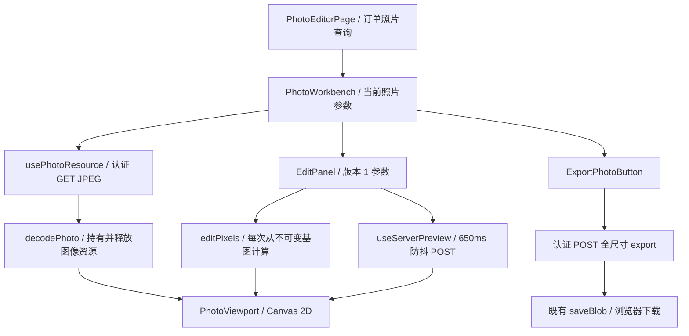
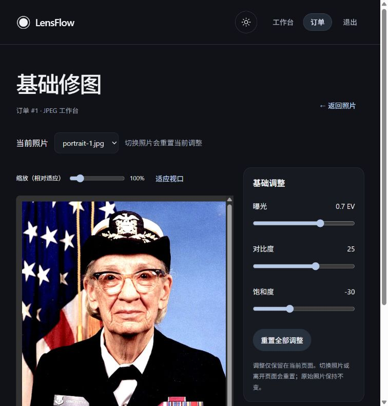
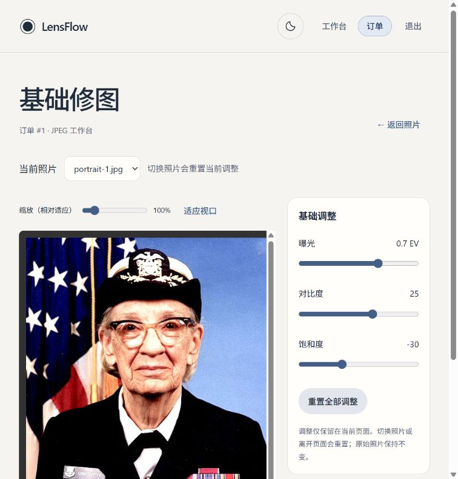

# LensFlow P2-A：真实照片预览与基础修图工作台

日期：2026-10-17。状态：实施与本轮验收完成，停止在 P2-A。

## 1. 范围与入口

新增摄影师路由：`/orders/:id/photos/:photoId/edit`。

- 复用现有 ProtectedRoute、Layout、Button、页面状态组件、认证 Axios 客户端、TanStack Query 与 saveBlob。
- 上传页的每张照片新增“基础修图”入口。
- 分析结果页的照片区新增“基础修图”入口。
- 页面再次检查 photographer 角色；照片必须出现在当前订单照片列表，实际文件权限仍由后端 Photo→Order 校验。
- 没有修改 RetouchPage、RetouchVersion、Delivery，也没有把 JPEG 导出自动当作修图版本或交付文件。
- 没有修改后端算法、数据库表、首页粒子或全局设计系统；没有修改项目依赖。

## 2. 组件与数据流



### 2.1 照片与资源管理

- 不拼接 storage_key，不使用静态图片 URL。
- 原始预览以 Axios `responseType: blob` 加载，后端最长边限制为 1024。
- 首选 createImageBitmap；资源所有者在切换、重试、卸载时 close。
- createImageBitmap 不可用时使用 HTMLImageElement，Blob URL 在加载成功或失败后均 revoke；卸载释放图像引用。
- 通过 AbortController 取消请求，同时用 effect 生命周期和照片/参数标识忽略过时响应。即使取消后解码才完成，也立即释放所得 bitmap。
- 切换照片使用独立的 keyed Workbench，参数明确重置，不让旧照片响应覆盖新照片。
- 基图加载失败显示重试；校对失败保留本地画面和当前参数，可以单独重试校对。

### 2.2 Canvas 视口

- 图片保持服务端归一化后的原始比例；不依赖照片表中可能尚未归一化的宽高计算画面。
- 默认适应容器，缩放为适应尺寸的 50%–400%，提供“适应视口”。
- ResizeObserver 更新可用尺寸，窗口变化后重新计算显示尺寸；Canvas backing pixels 和 CSS 展示尺寸分开。
- 视口背景固定为中性灰 #323232，不使用卡片光晕 class，也不使用 CSS 滤镜处理照片。
- 连续调整时 requestAnimationFrame 合并更新，先使用最长边 512 的交互基图；停止更新 160ms 后恢复最长边 1024 的精细本地预览。
- 每次都从原始预览生成的独立 ImageData 计算；不累加前一帧结果，不修改原图 Blob。
- 参数全部归零时直接显示 GET 得到的服务端基图。
- 服务端校对到达后直接绘制其像素，不重复应用编辑参数。

### 2.3 校对与导出

- 非零编辑停止 650ms 后调用 `POST /api/v1/photos/{photo_id}/preview`；每次变更取消旧计时器和请求。
- 仅当前照片 ID、参数 key、基图资源与重试版本对应的响应能够显示。
- 导出使用点击瞬间的参数快照，调用 `POST /api/v1/photos/{photo_id}/export`，超时 120 秒。
- 下载的是服务器返回的 JPEG Blob，不是 canvas.toBlob 或 Canvas 截图。
- 通过既有 saveBlob 下载，命名为 `photo-<id>-edited.jpg`。
- 导出期间防止重复点击；失败恢复按钮，离开照片时取消并忽略晚到结果。
- 401、403、404、413、415、422、429、503、网络失败均有明确反馈。401 同时遵循现有 Axios 登录失效处理。

## 3. 参数与数学契约

已逐一读取后端 image_editor.py、image_edit.py Schema 与 API，使用实际 `schema_version=1`：

| 参数 | 范围 | 默认值 | 步长 |
|---|---|---|---|
| exposure_ev | -2～2 EV | 0 | 0.1 |
| contrast | -100～100 | 0 | 1 |
| saturation | -100～100 | 0 | 1 |

TypeScript 有明确类型、冻结默认值、运行时有限数校验和版本/未知字段检查；不提供后端未实现的参数。

处理顺序：

1. 通过标准分段传递函数把 sRGB uint8 转为线性 RGB。
2. 曝光：`C *= 2^exposure_ev`。
3. 对比度：`C = (C - 0.18) * 2^(contrast/100) + 0.18`。
4. `Y = 0.2126R + 0.7152G + 0.0722B`。
5. 饱和度：`C = Y + (C - Y) * (1 + saturation/100)`。
6. 最后裁切至 [0,1]，转回 sRGB，再量化至 uint8；使用 ties-to-even 处理半整数舍入，匹配 NumPy rint 语义。

前端使用 JavaScript 浮点数，后端条带计算为 NumPy float32；不能据此声称所有像素精确相同。

## 4. 算法一致性：两层验收

### 4.1 算法数值测试

`src/utils/__fixtures__/image-edit-v1.json` 由当前后端实际 apply_edits 生成，包含真实 JPEG 中抽取的 256 个像素和 8 组边界色，共 264 个像素、10 组参数。

- 输入来自既有真实摄影 JPEG 测试样本，不是通过 JS 复制公式生成期望值。
- 约定纯数学容差：单通道绝对误差 ≤1 个 uint8 等级，RGBA 平均误差 <0.05。
- 对照测试通过；另外验证三个调整分别改变像素、原数组不变、归零恢复基图。

### 4.2 实际浏览器 JPEG 链路

测试工具：`frontend/tests/browser/image-editor-parity.html`，仅供 Vite 开发环境人工执行，不是生产应用路由，也未加入生产构建入口。

它使用生产代码中的认证 API 和 editPixels，获取真实 JPEG、在浏览器解码，再与服务端参数预览解码后的像素比较。包含 JPEG 重编码与浏览器解码差异。

预先采用的容差：RGB MAE ≤3、RMSE ≤8（uint8 0–255）。

| 参数 | RGB MAE | RGB RMSE | 单通道最大差值 |
|---|---:|---:|---:|
| 全零 | 0 | 0 | 0 |
| 曝光 +1 EV | 1.7263 | 2.6813 | 44 |
| 对比度 +50 | 1.6411 | 3.4374 | 54 |
| 饱和度 -100 | 0.4843 | 0.9032 | 11 |
| 曝光 +0.7、对比度 +25、饱和度 -30 | 1.5336 | 3.0484 | 43 |

五组均通过预设总体误差容差。**这不是逐像素一致**：JPEG 边缘和高对比区域有更大的局部差值。停止操作后工作台显示服务端校对结果，导出始终由后端负责。

原始测量记录：`docs/image-processing-p2-a/browser-parity.json`。

## 5. 实际测试与构建

工作目录：frontend；使用已有 Node/npm 与项目依赖。

```powershell
npx --no-install tsc -b
npm run build
npx --no-install vitest run --reporter=default --reporter=junit --outputFile=../.agentwork/p2-a/frontend-tests.xml
npm run lint
```

结果：

- TypeScript：通过。
- Vite 生产构建：通过，205 modules transformed；主 JS gzip 约 135.16 kB。
- 最终 Vitest：**32 个测试文件、199 项测试通过**，17.76 秒，无失败和未处理异常。
- 本次新增 7 个测试文件、44 项测试。
- Oxlint：退出码 0，新工作台无警告；保留原有 DarkroomVideoBackground 的 2 条及 ParticlePortrait 的 1 条警告，未修改这些文件。
- git diff --check：通过。

首次全量运行虽然 194 个断言通过，但因既有注册页加载真实 Beam 时 jsdom 没有 matchMedia，产生 2 个未处理异常，不能算通过。补充 test-setup.ts 的测试专用 matchMedia shim 后重跑通过，再新增 4 项视口测试并补充照片列表权限错误测试，完成最终 199 项回归。

现有测试仍会输出 jsdom Canvas 不可用提示、CSS 解析提示和部分 Toast act 提示；它们没有在最终运行中成为未处理异常。真实 Canvas 像素验收在浏览器执行，没有把 jsdom 画布 mock 当作真实图像结果。

JUnit：`.agentwork/p2-a/frontend-tests.xml`。

### 验收覆盖与证据类型

| 要求 | 验证方式 |
|---|---|
| 未认证不能加载 | ProtectedRoute 页面测试；实际浏览器首次访问跳转登录；隔离 API 另测 401 |
| 真实 JPEG 显示 | 实际浏览器通过真实登录、GET Blob、画布截图 |
| 宽高比、缩放、窗口变化 | fitPhoto 单测、ResizeObserver/缩放组件测试、浏览器 DOM 尺寸与缩放操作 |
| 三个滑块、归零、源像素不变 | 真实后端像素向量、Canvas 组件测试、浏览器操作 |
| 快速切图与过时响应 | 可控 Promise 竞态测试；浏览器连续选择两张照片 |
| Blob URL/bitmap/RAF/observer 清理 | 资源和 Hook/Canvas 生命周期测试 |
| 服务端校对误差 | 真实浏览器五组 JPEG 对照与 JSON 记录 |
| 全尺寸导出 | API 单测与实际浏览器下载后 Pillow 读取尺寸 |
| 403/404/413/422/429/503 | API 错误映射单测、导出失败与恢复单测 |
| 旧页面和设计系统 | 最终全量前端测试；受保护文件哈希检查 |

没有执行 Safari、Firefox 或完整移动设备浏览器矩阵，也没有把这些项目标记为通过。

## 6. 真实浏览器环境与下载

隔离测试入口使用临时 Vite 配置与独立后端，生产配置未改动：

- 前端：http://127.0.0.1:4218。
- 后端：http://127.0.0.1:8018。
- 数据库：`C:/Users/Chase/AppData/Local/Temp/lensflow-p2-browser-32ymrmsw/browser.sqlite`。
- 上传：同一临时根目录内 uploads。
- 用隔离摄影师账号通过现有登录页面登录，不使用生产账户。
- 照片 1 为既有 517×606 摄影 JPEG；照片 2 是同一真实照片离线放大到 1551×1818 的尺寸测试样本，用于证明导出不使用 1024 预览输入。

实际浏览器按钮触发的下载：`C:/Users/Chase/Downloads/photo-2-edited.jpg`。

读取结果：JPEG、1551×1818、532,396 字节、没有失效的 EXIF Orientation。浏览器内的同张预览为 874×1024。

验收后停止隔离服务并删除其临时数据库/上传目录；实际下载文件作为验收产物保留。真实开发数据库和上传目录不做清理。

## 7. 修改文件清单

### 生产前端

- src/App.tsx：新增受保护编辑路由。
- src/pages/photographer/UploadPage.tsx：每照片基础修图入口。
- src/pages/photographer/AnalysisResultPage.tsx：分析照片基础修图入口。
- src/pages/photographer/PhotoEditorPage.tsx：摄影师角色、订单列表、照片选择和 Workbench 生命周期。
- src/api/imageEdit.ts：认证 JPEG Blob API、取消、导出与错误反馈。
- src/utils/imageEdit.ts：版本化参数、校验、纯像素函数、视口几何。
- src/components/photo-editor/imageResource.ts：解码与资源释放。
- src/components/photo-editor/usePhotoResource.ts：基图加载与重试。
- src/components/photo-editor/useServerPreview.ts：防抖校对与竞态防护。
- src/components/photo-editor/PhotoViewport.tsx：Canvas、缩放、分辨率恢复、ResizeObserver。
- src/components/photo-editor/EditPanel.tsx：三个控件与重置。
- src/components/photo-editor/ExportPhotoButton.tsx：参数快照、下载与状态。
- src/components/photo-editor/PhotoWorkbench.tsx：组合与当前照片编辑状态。
- src/components/photo-editor/photo-editor.css：仅作用于编辑器的局部样式。

### 测试与说明

- src/test-setup.ts：补齐 jsdom matchMedia，不影响生产代码。
- src/utils/imageEdit.test.ts、src/utils/__fixtures__/image-edit-v1.json。
- src/api/imageEdit.test.ts。
- src/components/photo-editor/previewHooks.test.tsx、imageResource.test.ts、controls.test.tsx、PhotoViewport.test.tsx。
- src/pages/photographer/PhotoEditorPage.test.tsx。
- tests/browser/image-editor-parity.html、image-editor-parity.ts。
- docs/image-processing-p2-a.md 与 docs/image-processing-p2-a/ 截图、测量记录。

## 8. 已知限制与 P2-B 建议

1. 编辑状态仅在当前照片工作台内存中，切图、离开或刷新会重置，界面已明确说明；不宣称草稿已保存。
2. 前端本地与服务端 JPEG 有细小及局部明显的编码差异；当前服务端校对和后端导出具有最终权威。
3. 校对请求在浏览器取消后，服务端已开始的同步处理可能仍继续；下一次请求可能暂时得到 429，保留本地预览并允许重试。
4. 还没有持久导出任务、进度百分比或批量操作；下载成功提示仅表示已提交浏览器下载，不承诺操作系统已最终落盘。
5. 没有引入 RAW、裁剪、旋转、色温或额外图像框架。
6. 没有执行大规模照片、低性能移动设备或跨浏览器性能压力测试。

P2-B 可以在确认后再设计编辑草稿保存与恢复、原图哈希绑定、并发修改检测；如要把导出接入 RetouchVersion/Delivery，应作为独立业务集成明确授权与生命周期，不能自动复用本阶段下载结果替代交付。另建议补充 Safari/Firefox/移动端与色彩配置样本矩阵；性能有证据需要时再评估 Web Worker。

## 9. 实际截图

暗色工作台（真实照片、非零调整、服务端校对）：



浅色工作台（同一照片和调整，中性视口不改变照片色彩）：


