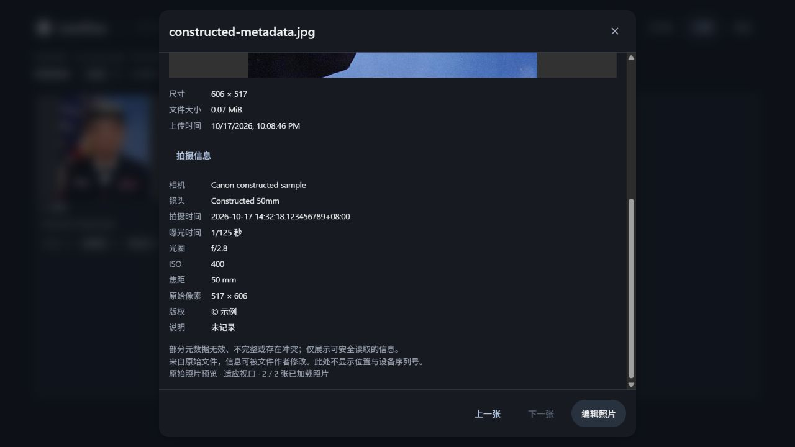
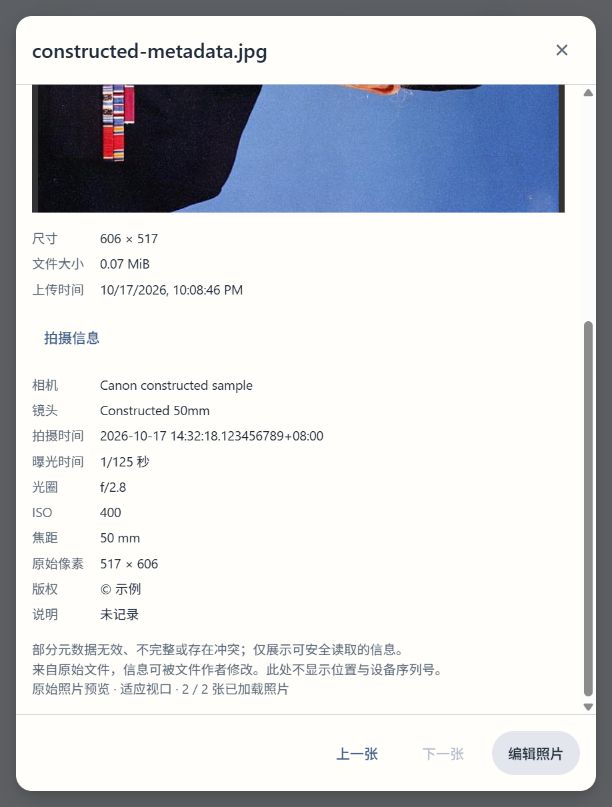
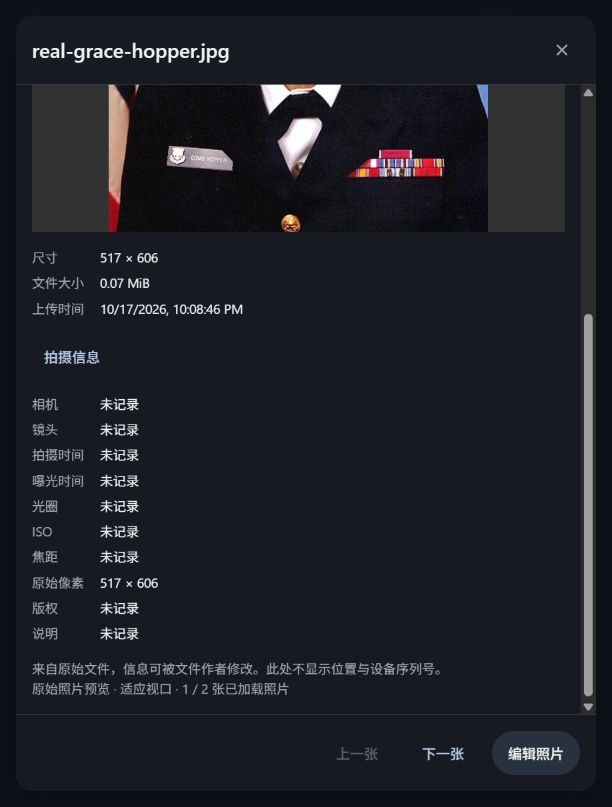

# LensFlow P3-C1：专业元数据提取与安全只读 API

日期：2026-10-17。工作分支：`design-system`。仓库：`C:/Users/Chase/Desktop/LensFlow`。

## 1. 结论与交付范围

已实现对真实 JPEG 原始字节的有界 EXIF、IPTC IIM、标准嵌入 XMP 提取、规范化、来源记录、敏感信息访问控制及 SHA-256 绑定，提供摄影师所属订单专用的只读 API；现有查看器增加按需展开的“拍摄信息”。

最终后端全量 **388 通过、1 跳过**，其中本轮元数据测试 **50 通过**；前端全量 **303 通过、50 个测试文件**。TypeScript、生产构建、修改文件的 Ruff 检查通过；前端 lint 退出码 0，保留既有 4 条警告。

已使用隔离 Uvicorn、SQLite、本地存储执行真实 TCP HTTP 上传、认证、提取、预览、导出，并在实际 IAB 浏览器验证查看器、深浅色展示、缺失字段、照片导航、图库/编辑器往返和双图灯箱。没有用 TestClient 代替 TCP 验证，也没有用 jsdom 代替浏览器验证。

没有新增数据库表、迁移或运行依赖。没有改变原图、Photo.storage_key、编辑参数、图像处理算法、草稿、标记语义、图库过滤/游标、缩略图配方、业务模型或首页粒子。保护文件快照共 51 个，最终全部字节不变。真实开发库没有升级，当前仍为 `5e0b2fd720d3`；现有代码 Alembic head 为 `c4e6a8b0d212`。没有开始 P3-C2。

## 2. 审计结果与依赖选择

| 实际模块 | 结论与复用方式 |
| --- | --- |
| `backend/app/models/photo.py` | Photo 关联 order_id、storage_key；尺寸字段来自上传规范化流程，不能替代本次原始 SOF 尺寸 |
| `backend/app/models/order.py` | photographer_id/client_id 决定订单归属；不修改模型 |
| `backend/app/services/photo_access.py` | 使用 require_photo_access(..., write=True) 校验数据库 Photo → Order；管理员不绕过，客户不进入详细元数据接口 |
| `backend/app/services/storage.py` | LocalStorage.open_read 是只读二进制流，get_path 已限制路径逃逸及解析后的根目录；OBS 尚不支持二进制读取 |
| `backend/app/services/image_editor.py` | 原有字节/像素/边长限制、预览/导出、方向与 ICC 转换继续独立工作；元数据不调用 normalized_source，不解码整图像素 |
| `backend/app/services/photo_catalog.py` / `api/v1/photo_catalog.py` | 目录是独立白名单 DTO；详细元数据不并入目录，不增加查询维度 |
| `backend/tests/conftest.py` | 导入应用前建立临时 SQLite/上传目录、隔离 SessionLocal、关闭真实通知，测试前后开发文件哈希守卫；继续沿用 |
| `frontend/src/components/photo-library/PhotoViewer.tsx` | 在现有 Modal 内增加独立详情组件；不改变照片 Blob/Bitmap 管理及灯箱 |
| `backend/pyproject.toml` / `backend/Dockerfile` | 已有 Pillow、NumPy、FastAPI、Pydantic 等；无独立 IPTC/XMP 安全解析依赖，未添加新依赖 |

开始时基线：后端 338 通过/1 跳过，前端 296 通过。工作区已有大量前序未提交代码，均予以保留；main.py 的 Git 整体 diff 包含前序工作，本轮只增加 metadata router 的导入与注册。

本机实际验证版本：Python 3.12.10、Pillow 12.3.0、FastAPI 0.143.2、Pydantic 2.14.1、SQLAlchemy 2.1.4、Expat 2.7.1。它们是本次执行环境，不代表所有宽松依赖版本均已验证。

采用标准库 struct 做显式 TIFF 白名单读取，避免为少量字段启用无界 IFD 遍历、缩略图和 MakerNote 处理；用标准库 Expat 的事件回调实现有界 XML 解析。禁止 DTD、实体声明、外部实体；不解析远程 schema，不做网络访问。Pillow 仅用于已有 ImageCms 读取受限 ICC 描述，以及独立测试对照。未引入 ExifTool，因此没有额外二进制部署、子进程隔离或新增许可证负担；本阶段也不声称完整覆盖 EXIF/IPTC/XMP 标准。

## 3. 数据流与只读保证

```text
Bearer 认证 → photographer 角色 → 持久化 Photo → Order 归属
  → 独立非阻塞并发许可（每进程 2 个；满载 429）
  → Storage.open_read → 至多 image_max_bytes + 1 字节
  → JPEG 标记结构与尺寸校验 → EXIF/IPTC/XMP/ICC 有界提取
  → 规范化、来源及警告 → 原始字节 SHA-256 → Pydantic 响应
```

同步路由由 FastAPI 在线程池执行，文件读取和解析不占用异步事件循环。没有后台全图库扫描，没有缓存，没有数据库写入。两种照片的连续读取及原文件内容变化后重新读取已验证，不依赖 PhotoEditDraft，也不读取已剥离 EXIF 的预览来生成信息。

哈希对同一份被解析的原始字节缓冲区计算，包含 EOI 后的原始尾随字节。服务只读，不修改文件、方向标签、storage_key、模型字段或任何业务记录。服务外部并发直接覆写原图不属于本模块承诺的原子文件快照；正常 LensFlow 工作流继续要求原图只读。

## 4. 支持范围、字段与规范化规则

### 4.1 JPEG / EXIF

- 支持 8-bit、1 或 3 分量、SOF0/SOF1/SOF2 的 JPEG 标记结构；支持扫描间 APP 元数据，检查 SOS、EOI、段长度与尺寸。其他 frame 或颜色模式返回 415。
- 不解码熵编码像素，不保证“结构有效”就一定可解码；像素完整性仍由既有上传/预览/导出管线负责。EOI 后数据参与哈希并返回 `jpeg.trailing_data` 警告，不作为元数据解析。
- TIFF 支持大小端，只读取 IFD0 及其一层 EXIF/GPS 子 IFD。指针、类型、个数、范围均检查；不跟随 next IFD、缩略图、厂商 MakerNote、BigTIFF 或任意递归链。
- 字符字段：Make、Model、LensMake、LensModel、BodySerialNumber、DateTimeOriginal、OffsetTimeOriginal、SubSecTimeOriginal、ImageDescription、Artist、Copyright。
- 数值字段：ExposureTime、FNumber、PhotographicSensitivity/ISOSpeedRatings、FocalLength、FocalLengthIn35mmFilm、ExposureBiasValue、Flash bit0、Orientation、EXIF ColorSpace。
- 有理数先检查分母非零，再计算；标量与 GPS 三元组个数分别校验。Orientation 仅接受 1–8；无效值返回 null 加警告。
- 不从文件名猜测相机或镜头；EXIF 可以人为修改，设备信息不是拍摄真实性证明。

### 4.2 IPTC IIM 有界子集

支持 APP13 `Photoshop 3.0` / `8BIM` / resource `0x0404` 中的 IIM 记录，包含标准及有界 extended length 编码：

| IIM 字段 | 输出 |
| --- | --- |
| 2:5 ObjectName | title |
| 2:120 Caption-Abstract | caption |
| 2:25 Keywords | keywords，去重并保留顺序 |
| 2:80 By-line | creator（多个标量取首个，警告） |
| 2:116 CopyrightNotice | copyright |
| 2:55 DateCreated / 2:60 TimeCreated | 独立 editorial date 候选；无时间则保留 date 精度 |

1:90 为 `ESC % G` 时按 UTF-8；未标记编码时按 Latin-1 回退并返回 `iptc.latin1_fallback`，不猜测本地 GBK 或其他代码页。不支持任意 Photoshop resource、所有 IIM 标签或其他 IPTC 嵌入容器。

### 4.3 标准嵌入 XMP 有界子集

支持 APP1 标准 `http://ns.adobe.com/xap/1.0/\0` 包，按 namespace URI 匹配，不依赖前缀名称。支持 RDF Description 紧凑属性及属性元素、rdf:Alt/Seq/Bag：

- dc:title / description / subject / creator / rights。
- xmp:CreateDate、photoshop:DateCreated，保留来源和日期精度。
- exif:GPSLatitude / GPSLongitude：标准 `度,十进制分N/S/E/W` 或带符号十进制度；不支持任意自由文本坐标。
- rdf:Alt 保留语言映射 `description.localized`；展示选择 x-default，缺少时按语言键字典序选择第一个有效项，并给 `xmp.language_fallback`。不是随意按 XML 遍历顺序选语言。
- creator Seq 的标量展示取第一个有效值；keywords 是去重后的有界列表。
- UTF-8、UTF-16 的正常包均有测试；DTD、内部/外部实体声明即拒绝该可选包并发出固定安全警告。禁止实体解析不依赖对字节做简单正则过滤。

不合并 Adobe Extended XMP 分片，遇到返回 `xmp.extended_unsupported`。不支持 sidecar、任意 RDF 图、所有 XMP namespace 或元数据写回。

### 4.4 ICC / 尺寸 / 数值

ICC APP2 分片必须编号连续、总数一致且无重复，才组装受限 profile；返回规范化描述和 ICC 字节 SHA-256。损坏 ICC 不影响其他安全字段，返回警告。ICC 描述不是已验证的设备身份；不据描述猜测工作色彩空间。EXIF ColorSpace 1 返回 sRGB，65535 返回 uncalibrated，缺少则 null。

`image.width/height` 始终是 JPEG SOF 存储像素，`oriented_width/oriented_height` 仅按有效原始 Orientation 5/6/7/8 对调，不做像素旋转。Photo 表已有尺寸可能来自方向规范化上传，与这里的存储尺寸命名不同。

| 数值 | 接受范围与单位 |
| --- | --- |
| exposure_seconds | 0.0000001–86400 秒 |
| f_number | 0.1–1024 |
| iso | 1–10,000,000，整数 |
| focal_length_mm | 0.1–100000 mm |
| focal_length_35mm_mm | 1–65535 mm，整数 |
| exposure_bias_ev | -100–100 EV |
| flash 原始位域 | 0–65535，输出 bit0 布尔值 |
| GPS latitude/longitude | -90–90 / -180–180 度；DMS 分秒均小于 60 |
| GPS altitude | 绝对值 0–100000 m，必须有有效海拔参考方向才输出符号 |

## 5. 版本化 Schema、优先级与缺失策略

Pydantic 合同：`backend/app/schemas/photo_metadata.py`，`extra=forbid`、禁止非有限浮点，顶层 `metadata_version=1`。

顶层固定为 photo_id、source_sha256、metadata_version、camera、capture、description、image、gps、provenance、warnings。完整实际响应保存在 [无 EXIF 真实照片响应](image-processing-p3-c1/http-metadata-1.json) 和 [注入样本响应](image-processing-p3-c1/http-metadata-2.json)。

| 项目 | 决策 |
| --- | --- |
| camera / capture 数值字段 | 仅 EXIF，不从描述、文件名或其他日期推断 |
| title | XMP > IPTC；没有不发明 EXIF title |
| caption | XMP > IPTC > EXIF ImageDescription |
| creator / copyright | XMP > IPTC > EXIF Artist / Copyright |
| keywords | 非空 XMP 列表优先，否则 IPTC；不默默合并互相矛盾的列表 |
| 同源重复包/重复标量/重复 tag | 首个值优先，返回固定 duplicate 警告；首次损坏不静默接受后续替代包 |
| GPS | 优先完整有效 EXIF 经纬度对，否则完整 XMP 对；不跨来源拼接纬度/经度 |
| EXIF DateTimeOriginal | 是 date_time_original 的唯一来源，存在时记录 provenance |
| IPTC/XMP 日期 | 放入 date_candidates，保留 source/value/timezone_known/precision，不把编辑/创作日期冒充拍摄时间 |
| 多日期不同 | 保留全部有效候选并给 capture.date_ambiguity，不猜测它们表示同一时刻 |

EXIF 日期接受已知 `YYYY:MM:DD HH:MM:SS` 及严格 ISO 形式，子秒保留 1–9 位；有效 offset 仅 -14:00 至 +14:00，分钟须合法。缺少 offset 保留无时区 ISO 字符串，不按服务器或浏览器时区补齐；无效 offset 独立警告，仍保留有效本地拍摄时间。date-only 候选不补午夜或虚构秒精度。

缺少字段为 null、缺少集合为 []/{}；损坏字段为 null 并伴随固定 warning；没有 EXIF 并不报错。`timezone_known=false` 表示偏移未知或没有拍摄时间，需结合日期字段判断。权限不足是 403，不伪装成“字段为空”；本阶段没有给客户的“删除敏感字段后详细响应”。

文本使用受限 UTF-8、Unicode 字符串；EXIF 非法编码置空警告，移除控制/格式字符（换行、tab 保留），超长输出截断并警告。没有 raw tag 字典、原始 XML、MakerNote、所有者私有标签透传。前端用 React 文本渲染，不使用 innerHTML。

## 6. 资源限制与错误分类

| 边界 | 当前默认值/处理 |
| --- | --- |
| 原始字节 | 沿用 image_max_bytes：20 MiB；多读 1 字节检测超限，413 |
| SOF 像素与边长 | 沿用 24,000,000 pixels / 12000 px，413 |
| JPEG 单段 | 标准 16-bit 长度：payload 最多 65533 bytes，声明与实际长度必须一致 |
| APP0–APP15 与 COM 总 payload | 2 MiB，未知 APP 也计入，413 |
| 有长度/结构标记数 | 4096；不将 entropy byte stuffing / restart 计为元数据段 |
| JPEG scan 数 | 256 |
| EXIF | 每 IFD 最多 256 tags，整个解析最多 512；只访问固定 3 个 IFD |
| EXIF 文本读取 | 最多 4096 bytes/tag；默认输出 1024 characters |
| XMP | 每包 60 KiB；2048 nodes；16 层；每 node 32 attrs；元素/属性名最多 512 chars |
| XMP 文本/属性值 | 单节点文本及属性值最多 4096 chars；超过结构边界 413 |
| rdf:Alt | 每字段 16 种语言，语言键 1–35 个安全字符 |
| IPTC | Photoshop resource 最多 128，总 IIM records 最多 512 |
| 输出文本 | 默认 1024 chars；IPTC/XMP caption 4096；keyword 128 |
| keywords | 最多 64 个，去重保序；截断警告 |
| ICC | 总 profile 最多 1 MiB，同时受 APP 总量限制 |
| 并发 | 每 worker 2 个，非阻塞申请，超限直接 429；不建立等待队列或后台抽取任务 |
| 缓存 | 无；每次授权后读取实际源字节、重新哈希与解析 |

有效结构 JPEG 的可选损坏包优先返回 200 + warnings，能读取的其他字段保留。字节/结构预算超限返回 413；JPEG 结构损坏返回 422；不支持的 JPEG frame/颜色返回 415。不存在照片或文件为 404；本地 I/O 不可用、未实现 OBS 二进制读取为 503。未预料的错误为固定脱敏 500，不在 APP_DEBUG 模式回显原始异常。

## 7. API 与隐私策略

```http
GET /api/v1/photos/2/metadata
Authorization: Bearer <摄影师 access_token>
```

- 仅所属订单摄影师；客户、其他摄影师、管理员均 403。先鉴权与对象归属，后读文件。
- 不接受 section、路径、storage_key、order_id 或其他 query；未知或重复参数均因不接受 query 返回 422。
- 没有请求 body，不接收客户端 hash。
- 成功/本路由错误响应均为 `Cache-Control: private, no-store, max-age=0`、`Pragma: no-cache`、`Vary: Authorization`、`X-Content-Type-Options: nosniff`；CORS 可追加 Vary: Origin。
- 未认证 401 沿用 Bearer 的 detail 响应；应用错误沿用 `{code,message,detail}`。例：503 `STORAGE_UNAVAILABLE`，429 `METADATA_BUSY`，413 `METADATA_TOO_LARGE`。

真实 HTTP 注入样本响应节选（**这是构造元数据，不是真实 Canon 相机原片**）：

```json
{
  "metadata_version": 1,
  "photo_id": 2,
  "source_sha256": "6bf54b0afd175596c57d6a2b92f43ac1bcb8d9e55ff2f19bcb3b8dfc9f3c41a3",
  "camera": {"make": "Canon", "model": "Canon constructed sample", "lens_model": "Constructed 50mm"},
  "capture": {"date_time_original": "2026-10-17T14:32:18.123456789+08:00", "timezone_known": true, "exposure_seconds": 0.008, "f_number": 2.8, "iso": 400, "orientation": 6},
  "image": {"width": 517, "height": 606, "oriented_width": 606, "oriented_height": 517},
  "warnings": ["description.title.conflict"]
}
```

所属摄影师的详细 API 有权得到规范化 GPS 和设备序列号。客户没有访问此 API 的权限，目录 DTO 不增加任何 GPS、序列号、XMP 原始内容或详细描述字段。日志只记录路径/状态/耗时，不记录 metadata body、坐标、鉴权 token、文件私有标签或原始解析异常；不调用地图、地理编码、第三方元数据服务或分析系统。

## 8. 查看器集成与资源生命周期

新增 `MetadataDetails`，由现有 PhotoViewer 引入，复用 Button、LoadingState、ErrorState、Modal 及字体/主题 tokens。只读“拍摄信息”展示相机、镜头、拍摄时间、曝光、光圈、ISO、焦距、原始尺寸、版权和说明；不添加编辑控件或路由。

`frontend/src/api/photoMetadata.ts` 使用现有认证 Axios、校验版本/photo_id/source hash/字段类型，并构造独立展示白名单；GPS、序列号、原始 provenance 等不进入 UI state。组件检查摄影师角色，用户及 photo_id 作为会话 key。展开才挂载请求，收起/切换/卸载 AbortController 取消，promise 晚到时也检查 aborted；失败不影响原预览，可重试。

图库虚拟卡片及双图灯箱没有新增元数据请求。未展开面板没有请求。没有新 Blob URL、ImageBitmap 或照片缓存，沿用照片预览组件的生命周期；仅有文字面板局部防长文本溢出样式。

实际截图：







截图中的构造 Orientation=6 特意将原照片转为横向，以验证原始存储尺寸与方向规范化预览的区别，不能理解为真实拍摄方向信息。

## 9. 测试命令与实际结果

Python 运行器：`C:/Users/Chase/Desktop/LensFlow/.agentwork/design-system/p5-venv/Scripts/python.exe`。

从 backend 目录执行：

```powershell
& ../.agentwork/design-system/p5-venv/Scripts/python.exe -m pytest tests/test_photo_metadata.py -v --tb=short --junitxml=../docs/image-processing-p3-c1/backend-metadata.xml
& ../.agentwork/design-system/p5-venv/Scripts/python.exe -m pytest -q --tb=short --junitxml=../.agentwork/p3-c1/backend-full.xml
```

结果分别为 50 passed / 28.37s，以及 388 passed, 1 skipped, 9 warnings / 317.66s。详细 JUnit 已复制到本报告同名证据目录。跳过是现有 Windows 符号链接创建权限限制；既有 Starlette/httpx、Alembic path_separator 警告未在本阶段更改。

50 项本轮测试覆盖真实照片无 EXIF、Canon/Nikon/SONY 构造标签（大小端）、未知镜头、EXIF 与 Pillow 独立值对照、时区/子秒/非法日期、无效 rational、异常类型/个数/指针、重复/长文本/控制字符/MakerNote、IPTC、命名空间和多语言 XMP、UTF-16、XXE/DTD、XML 与 APP 总量预算、ICC、非法 JPEG/尺寸、SHA、文件变更、角色与归属、原图/全库逻辑快照只读、路径逃逸、OBS、I/O 脱敏、429 许可释放、预览/导出和客户目录隐私。此外执行 300 轮确定性 EXIF 字节变异检查；这不是全面 fuzzing 或安全审计的替代品。

从 frontend 目录执行：

```powershell
npx --no-install vitest run --reporter=default --reporter=junit --outputFile.junit=../.agentwork/p3-c1/frontend-full.xml
npx --no-install vitest run src/api/photoMetadata.test.ts src/components/photo-library/MetadataDetails.test.tsx src/components/photo-library/PhotoViewer.test.tsx
npx --no-install tsc -b
npm run build
npm run lint
```

全量 303 passed / 50 files；定向 9 passed（含原有查看器 2 项）。新增 7 项覆盖响应白名单和身份验证、认证请求与 signal、按需请求、加载/缺失/错误/重试、晚到隔离/取消、角色变更清空、文本转义和隐私字段不展示。局部样式加入后再次执行定向测试、tsc、build、lint，均成功。既有 PhotoLibrary/LightTable/Editor 组件回归包含在全量测试中。

Lint 既有 4 警告：DarkroomVideoBackground 两处 set-state-in-effect；ParticlePortrait effect dependency；AssetGrid 的 TanStack Virtual React Compiler 兼容性。原有 Toast act / jsdom Canvas 提示不算真实浏览器绘制验证。

从仓库根目录执行修改范围 Ruff check，涉及 3 个服务、schema、API、2 个测试文件，全部通过；未格式化无关文件。

## 10. 隔离环境、真实文件和 TCP / 浏览器证据

### 隔离

- 最后定向 pytest 实际数据库：`C:/Users/Chase/AppData/Local/Temp/lensflow-pytest-5edtdzq2/test.sqlite`，日志见 `metadata-pytest.log`；测试结束已自动删除整个沙箱。
- 真实 HTTP/浏览器数据库：`C:/Users/Chase/AppData/Local/Temp/lensflow-p3c1-browser-fcqm9gdn/browser.sqlite`；上传目录是同一沙箱的 uploads。
- 只有隔离数据库执行 Alembic upgrade head；后台分析 SessionLocal 指向同一隔离 DB，通知配置为空；真实开发存储在前后哈希保护范围内。
- 服务端口 8051，Vite 4251；本轮浏览器标签已关闭，两端口已关闭，TemporaryDirectory 已自动清理，详见 `cleanup.json`。
- 本轮没有访问或再次尝试清理 P3-B3 留下的其他任务临时目录。

### 真实文件与 HTTP

仓库真实照片 `backend/tests/fixtures/grace_hopper.jpg`：517×606，73746 bytes，原文件 SHA-256：

```text
e1f57e98cf38076c0f9a058d74ffddf90f20453e436033784606b63c8ed2e49a
```

该文件确实没有 EXIF，独立 Image.open(...).getexif() 检查确认；没有捏造它的相机信息。实际 TCP 通过登录取得 Bearer，上传该原照及其 74816-byte 元数据注入副本，各自请求 metadata/preview/export。副本保留真实 JPEG 像素压缩数据，只插入构造的 APP 段；不是 Canon/Nikon/Sony 相机原片。测试中使用的厂商名均明确标记 constructed。

两张照片：摄影师 200，客户 403，其他摄影师 403，匿名 401；客户目录没有位置或序列号字段。注入副本的 EXIF make、曝光、光圈、ISO、方向与独立 Pillow 读取一致。原照导出 517×606，Orientation=6 副本导出 606×517；JPEG 像素可加载、导出没有原始 EXIF。HTTP 只读阶段及全部浏览器操作后，原文件 SHA 和 SQLite 全表 iterdump 一致。

### 实际浏览器

登录摄影师后打开图库、照片、拍摄信息，检查相机、镜头、子秒时区、1/125 秒、f/2.8、ISO400、50mm；切到真实无 EXIF 照片后是“未记录”。详情切图复位，深浅色都检查。进入编辑器看到服务端校对图和基础/几何控件，返回图库选择两张，A/B 原始认证预览均显示。

服务端日志计数确认：网格及收起详情请求为 0；本轮三个展开动作各对应一次 200 metadata 请求。实际浏览器控制台 error 列表为空。未在真实浏览器强制注入网络失败或竞态；错误/重试/晚到等由组件测试覆盖，不将它们冒称为浏览器故障注入通过。视口随应用窗口曾变化，检查了可见窄窗口和桌面面板，但未执行独立真实手机/Safari 验收。

证据文件：`http-verification.json`、`http-events.json`、`browser-verification.json`、`immutability.json`、`cleanup.json`、`backend-full.xml`、`backend-metadata.xml`、`frontend-full.xml`、实际截图、构造 JPEG 和两份实际 metadata 响应。

## 11. 性能与内存观察

同一本机客户端进程内，预热后各 20 次 normalize_metadata，开启 tracemalloc；不是并发压力测试，也不包含磁盘读取、HTTP、初始输入缓冲区分配或原生 LCMS 内存：

| 样本 | 字节 | 中位耗时 | 最大耗时 | Python 追踪峰值（不含输入） |
| --- | ---: | ---: | ---: | ---: |
| 真实照片 | 73746 | 1.705 ms | 2.415 ms | 13019 B |
| 注入 EXIF/IPTC/XMP 副本 | 74816 | 2.572 ms | 4.221 ms | 23188 B |
| 近字节上限构造输入 | 19922944 | 13.927 ms | 16.262 ms | 12395 B |

第三项仅是在真实 JPEG EOI 后添加零字节的 19 MiB 构造文件，用来观察全源哈希成本，不是 19 MiB 高分辨率相机照片，也不是恶意 2 MiB 元数据最坏解析耗时。该类输入会给 trailing_data 警告。不能把上表外推为所有大照片、平台或混合压力的性能保证。

实际请求仍需持有原始文件缓冲区（默认每份最多 20 MiB + 1）；两个 metadata slot 约束的是每 worker 的活跃请求，不是整站 RSS 硬上限。增加 Uvicorn worker 会乘以并发容量；原有一个 render slot 仍独立。未测长期 RSS、完整 24MP 压力、恶意语料大规模 fuzz 或多 worker 稳态内存。

## 12. 本轮修改文件

| 文件 | 职责 |
| --- | --- |
| `backend/app/schemas/photo_metadata.py`（新增） | V1 typed response |
| `backend/app/services/metadata_segments.py`（新增） | JPEG 与 TIFF 有界读取、结构和尺寸检查 |
| `backend/app/services/metadata_embedded.py`（新增） | IPTC、禁止实体的 XMP、文本与关键词规则 |
| `backend/app/services/photo_metadata.py`（新增） | 原始源读取、并发、规范化、优先级、日期/GPS/ICC/SHA |
| `backend/app/api/v1/photo_metadata.py`（新增） | 所属摄影师 API、错误脱敏与私有缓存头 |
| `backend/app/main.py`（局部修改） | 只加入 metadata router 导入/注册 |
| `backend/tests/metadata_samples.py`（新增） | 基于真实照片的构造元数据工具，明确非相机原片 |
| `backend/tests/test_photo_metadata.py`（新增） | 50 项元数据与安全/回归验证 |
| `frontend/src/api/photoMetadata.ts` / `.test.ts`（新增） | 认证请求与严格 UI 展示白名单 |
| `frontend/src/components/photo-library/MetadataDetails.tsx` / `.test.tsx`（新增） | 按需只读详情及生命周期测试 |
| `frontend/src/components/photo-library/metadata-details.css`（新增） | 仅该面板防长文本溢出 |
| `frontend/src/components/photo-library/PhotoViewer.tsx`（局部修改） | 引入并挂载详情组件 |
| `docs/image-processing-p3-c1.md` / 同名目录（新增） | 本报告、实际测试及视觉证据 |

复现辅助脚本位于 `.agentwork/p3-c1/browser_backend.py`、`verify_http.py`、`vite.config.mjs`；只用于隔离验收，不是生产 API。`/__metadata_test_shutdown__` 只在临时验证进程注册，未加入生产 app 源码。没有修改模型、Alembic、依赖清单、Dockerfile或全局设计系统。

## 13. 已知限制、部署与 P3-C2 建议

1. 实现的是明确的 EXIF/IPTC/XMP 子集；不覆盖厂商 MakerNote、扩展 XMP、任意 RDF 图、sidecar、写回、全文搜索、RAW/DNG 或地理服务。
2. 缺少真实 Canon/Nikon/Sony 相机原片语料；当前厂商相关测试是注入构造数据。上线前应补充有授权、可核对元数据的多厂商真实 JPEG，尤其旧 IPTC 编码与多 ICC 分片语料。
3. JPEG 标记校验不代替像素解码，现有上传/预览/导出保持原有安全校验；对存量外部直接导入的损坏压缩数据，metadata 可读与照片可预览是不同结果。
4. OBS 读取明确 503。需以后先完善 Storage 的认证二进制读取、字节上限和资源关闭，再接入此服务；不能把 OBS URL 当本地路径，也不回退公开访问。
5. 无缓存、无新增表，本阶段不需迁移。已有图库/草稿/标记依赖前序迁移；真实开发库尚落后，必须由受控部署流程单独评估与升级，不能将本次隔离环境验证当成开发库已部署。
6. 部署沿用 Python + Pillow/LCMS；保持 Python/Expat/Pillow 安全更新及每 worker 容量规划。当前测试在 SQLite 和本机浏览器，未单独执行 PostgreSQL 在线元数据流程、生产 OBS、Safari 或真实移动设备。
7. 候选日期保留语义与歧义，后续可增加单独日期展示，不应把 XMP/编辑日期自动当拍摄时间。客户安全摘要若需要，必须先定义显式白名单及 GPS/序列号授权政策。
8. P3-C2 可优先补充更多真实语料、诊断代码说明、完整多作者展示及更深入性能/模糊测试；若引入索引或缓存，键应包含 source_sha256 与 metadata_version，并保持权限先于缓存。元数据编辑/sidecar/索引需要独立设计和确认。

本阶段到此停止。
