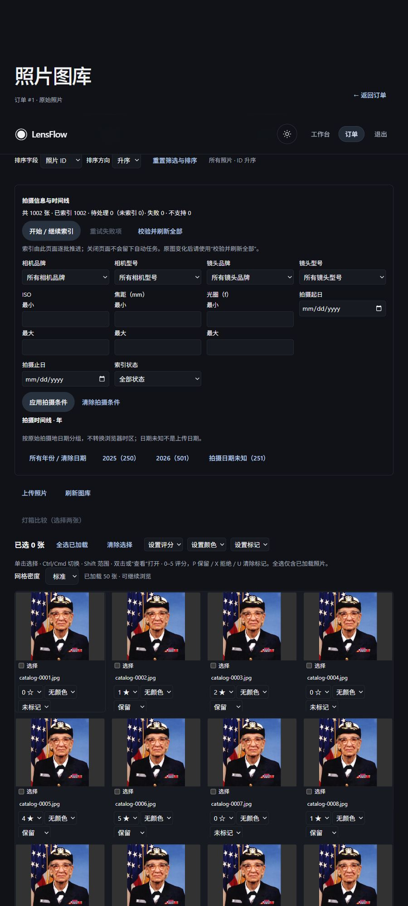
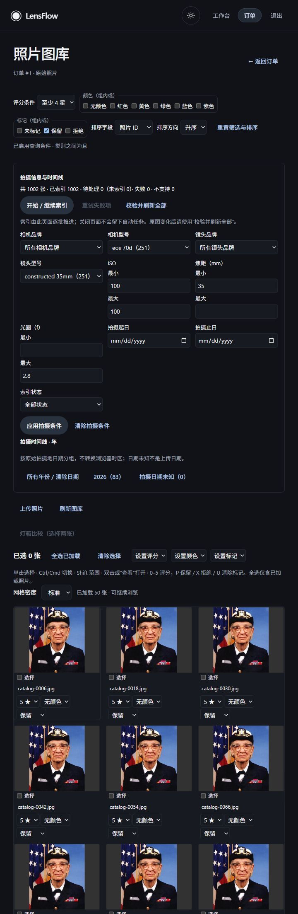

# LensFlow P3-C2 交付报告：可检索元数据索引、设备筛选与拍摄时间线

完成日期：2026-10-18（Asia/Shanghai）。测试与浏览器证据跨 2026-10-17 至 2026-10-18，原始记录保留实际时间。

## 1. 结论与实际范围

已在现有摄影师图库中实现持久化元数据索引、按小批次继续/重试、数据库级相机/镜头/ISO/焦距/光圈/拍摄日期筛选，以及年→月→日和日期未知导航。查询覆盖整个有权访问的订单，继续使用现有 SQL keyset 分页、虚拟网格、评分/Pick 和编辑器/灯箱流程。

实现采用独立的可重建索引表，复用 C1 提取器。上传成功与索引完成相互独立；没有增加自动运行且声称可持久恢复的后台队列。关闭页面会停止续批，已提交的索引和状态保留，重新打开后可以显式继续。

实际 TCP/浏览器环境处理了 1002 张同一订单照片记录；设备、数值、评分/Pick 组合筛选的 83 个结果与独立预期逐一一致。所有原始文件哈希未变，索引操作前后的 19 个非索引表内容未变（包括 `alembic_version`，不是 19 个业务表）。保护快照中的另外 50 个文件未变。

**真实开发数据库没有迁移。** 当前开发库仍为 `5e0b2fd720d3`，新 Alembic head 为 `d5f7a9c1e323`。本阶段运行过的迁移均在临时测试库中。部署前需要单独完成数据库备份、迁移链检查与发布安排。

## 2. 审计依据与最小集成

审计了上传/照片生命周期、现有进程内分析任务、LocalStorage/OBS 能力、C1 规范化结果、C1 源字节指纹、现有迁移、B3 查询与签名游标、注释 JOIN、URL/query key、权限及隔离 fixture。

关键选择：

- `Photo` 继续作为资产身份，索引不改变 `Photo.storage_key` 或任何像素编辑状态。
- 现有分析使用进程内执行机制，没有可作为索引完成保证的持久 worker。因此选择小批量 HTTP 请求和前端续批。
- LocalStorage 使用既有受根目录约束的只读接口；OBS 尚无本阶段所需的二进制读取支持，明确记录为 `unsupported`。
- 元数据提取/文件读取在同步 FastAPI handler 的线程工作中进行，不在异步事件循环直接执行。
- 原图读取和解析不持有整批数据库事务。每张照片分别认领、处理、发布。
- 不新增依赖，不更换框架；C1 提取器、像素算法、缩略图配方、注释 CAS、首页粒子和全局设计系统保持原有实现。

入口和依赖依据：`backend/app/main.py`、`backend/app/api/v1/photos.py`、`backend/app/services/photo_metadata.py`、`backend/app/services/storage.py`、`backend/app/services/photo_catalog.py`、`backend/tests/conftest.py`、`frontend/src/pages/photographer/PhotoLibraryPage.tsx`、`frontend/src/components/photo-library/usePhotoCatalog.ts`。

## 3. 文件清单

以下为本阶段文件，不代表工作区全部 Git 改动。仓库已有大量前序阶段未提交/未跟踪文件，本阶段没有 reset、clean 或提交。

### 后端新增

| 文件 | 职责 |
| --- | --- |
| `backend/app/models/photo_metadata_index.py` | 派生索引、唯一约束、状态/值域约束、租约 |
| `backend/alembic/versions/d5f7a9c1e323_photo_metadata_index.py` | 独立新表、索引及可逆迁移 |
| `backend/app/schemas/metadata_index.py` | 索引、批次、统计、facets、timeline 响应 |
| `backend/app/schemas/metadata_filters.py` | 保守设备名称规范化、数值/日期校验 |
| `backend/app/services/metadata_index.py` | 指纹复用、CAS 租约、逐图提交、继续/重试 |
| `backend/app/services/metadata_search.py` | SQL 谓词、设备聚合、时间线聚合 |
| `backend/app/api/v1/metadata_index.py` | 摄影师授权 API |
| `backend/tests/test_metadata_index.py` | 38 项持久化、权限、筛选、游标、迁移等测试 |
| `backend/tests/test_metadata_index_edges.py` | 15 项繁忙、时限、排序、截断、删除竞争等边界测试 |

### 后端窄修改

- `backend/app/models/__init__.py`：注册新模型。
- `backend/app/main.py`：注册新路由。
- `backend/app/schemas/catalog_filters.py`：为既有查询增加可选元数据规范化身份。
- `backend/app/services/photo_catalog.py`：仅在元数据条件启用时增加唯一索引 JOIN 和 V3 游标。
- `backend/app/api/v1/photo_catalog.py`：允许新查询键，维持客户隐私限制。
- `backend/tests/test_photo_annotation.py`：注释迁移专属测试明确升级到其目标 `c4e6a8b0d212`，不再把后来新增的 head 错当成注释迁移版本。

### 前端新增

- `frontend/src/api/metadataIndex.ts`、`metadataIndex.test.ts`：认证请求、取消信号、响应边界检查。
- `frontend/src/utils/metadataFilters.ts`、`metadataFilters.test.ts`：类型、URL 校验与序列化。
- `frontend/src/components/photo-library/MetadataTools.tsx`、`MetadataTools.test.tsx`、`metadata-tools.css`：状态、批处理、设备与范围表单、时间线。

### 前端窄修改

- `frontend/src/utils/catalogFilters.ts`：沿用既有 URL 契约增加可选 metadata。
- `frontend/src/pages/photographer/PhotoLibraryPage.tsx`：在现有 CatalogSession 中集成工具区；无新增路由。
- `frontend/src/components/photo-library/useAnnotations.ts`：完成既有注释流程后刷新时间线，未改变 CAS 行为。
- `frontend/src/pages/photographer/PhotoLibraryPage.test.tsx`、`CatalogNavigation.test.tsx`：原页面单元测试隔离新增子组件；子组件有独立测试。

证据与可复现辅助脚本分别在 `docs/image-processing-p3-c2/` 和 `.agentwork/p3-c2/`。辅助服务的关闭端点只注册在测试脚本中，未加入产品应用。

## 4. 模型、迁移与删除语义

模型：`PhotoMetadataIndex`，表：`photo_metadata_indexes`。

- 每个 `photo_id` 最多一行，外键指向 `photos.id`，`ON DELETE CASCADE`。
- 索引字段包括规范化设备四字段、ISO、焦距、光圈、曝光秒数、原始拍摄墙上时间、显式时区偏移、拍摄日期和时区已知标记。
- 源身份为 `source_sha256`、`parser_version`，并保存状态、索引时间、固定错误码、警告数。
- `lease_token`、`lease_expires_at`、`revision` 用于并发和中断恢复，不是业务编辑版本。
- 缺失值为 NULL；无 EXIF 的合法 JPEG 可以成功 `indexed`，所有拍摄字段为空。
- 数据库约束检查状态、64 位小写十六进制 SHA、非空 parser version、revision、数值范围和时区一致性；`indexed` 必须有指纹与索引时间。
- 不存 GPS、相机序列号、原始 MakerNote/XMP 或人工评分/Pick。

迁移链：`c4e6a8b0d212 → d5f7a9c1e323`。迁移不自动扫描原图或回填索引，不改既有 Photo 行。downgrade 只删除该派生表。

索引包含 camera_model、lens_model、capture_date 的普通索引及 photo_id 唯一索引。实际 SQLite catalog 查询计划选择的是订单索引、注释唯一索引及 metadata 的 photo_id 唯一索引；不能据此声称三个普通索引已在当前查询计划中起效。更大数据集的复合索引需用后续测量决定。

## 5. 索引身份、状态机与恢复

### 5.1 身份

当前 parser contract 为 `c1-v1.index-v1`。C1 提取或索引规范化契约变动时，需要显式提升版本。

每次逐图索引/refresh 都从实际存储读取有上限的源字节并计算 SHA-256。仅当此前成功状态、实际源哈希、parser version 均一致时复用提取字段；仍会读取/校验源字节，不把浏览器传来的哈希作为依据。

catalog/facets/timeline 查询仅使用数据库，不读取或 hash 原文件。外部直接替换存储文件不会被普通查询自动发现，需要“校验并刷新全部”或逐图刷新。业务本身仍要求原图只读。

### 5.2 状态

| 状态 | 含义与恢复 |
| --- | --- |
| 无索引行 | 尚未处理；计入 pending 和 unindexed，普通图库仍可浏览 |
| pending | 已认领、处理资源繁忙，或版本过期待重建；不意味着存在自动队列 |
| indexed | 提取完成；无 EXIF 不构成失败 |
| unsupported | 非支持格式或缺少存储读取能力；能力/源文件改变后可显式重试 |
| failed | JPEG/I/O 等失败；保存白名单错误码，修复后显式重试 |

C1 的可恢复可选元数据问题保留为成功结果加 `warning_count` 和 `METADATA_WARNINGS`，不是悄悄丢弃警告。损坏的 JPEG/提取失败不会伪装为空的成功索引。

统计恒有 `total = indexed + pending + failed + unsupported`。`unindexed` 是 pending 的子集。旧 parser 的行算作 pending；`active` 是有效租约数量。`generation` 是不透明变化标记，最终实现也包含 parser version。

### 5.3 并发与中断

1. 在短事务中创建/读取唯一索引行，并通过条件 UPDATE 认领 120 秒租约。
2. 提交认领事务后只读原图、复用 C1 的处理槽。C1/C2 共用每进程两个槽；这不是跨所有 worker 的全局两个槽。
3. 发布时必须匹配原 token。旧 worker 不得覆盖新租约；失去发布资格时返回 `busy=true`，不宣称本次已发布。
4. 同时请求相同照片时，已有有效租约者得到 busy 状态，不重复开始解析。
5. 中断后状态留在数据库；租约到期后新的授权请求可以继续。没有自动后台补跑承诺。
6. 创建/认领、发布阶段的数据库 OperationalError 均 rollback，返回 `INDEX_DATABASE_BUSY / 503`。发布失败时已提交租约仍需到期恢复，避免把未发布结果当作 indexed。
7. 选择批次后照片被删除时跳过，不重建已删除 Photo；其它数据库错误不伪装为成功。

每次批量请求默认 5 张，范围 1–10；前端每批请求 10 张。1.5 秒是文件之间检查的软预算，不是可强制终止单次文件系统读取的硬期限。单文件继续受 C1 字节/元数据限制（本环境 image_max_bytes 为 20 MiB）约束。

`missing` 处理无行、旧版本和 pending；`retry` 额外处理 failed/unsupported；`refresh` 校验所有照片。签名继续游标绑定用户、订单、mode、进度与初始 Photo.id 上界，上限 320 字符。新上传超出该轮上界的照片在下轮处理。

## 6. API 契约

除客户原有默认 catalog 外，下列元数据能力均需 Bearer 登录、photographer 角色及实际订单归属校验。管理员角色没有被自动赋予这一摄影师私有操作。客户端不能传路径/storage_key。

| 方法 | 路径 | 输入 | 输出 |
| --- | --- | --- | --- |
| POST | `/api/v1/photos/{photo_id}/metadata-index` | 必须为 `{}`，禁止额外字段 | 单照片 IndexResult，含 busy/reused/status/白名单字段 |
| POST | `/api/v1/orders/{order_id}/metadata-index` | mode、limit、可选 cursor | results、next_cursor、counts、`continuation: client_driven` |
| GET | `/api/v1/orders/{order_id}/metadata-index/status` | 无查询参数 | total/indexed/pending/failed/unsupported/unindexed/active/generation/parser_version |
| GET | `/api/v1/orders/{order_id}/photos/metadata-facets` | 无查询参数 | 四组规范化设备值+count、truncated、counts |
| GET | `/api/v1/orders/{order_id}/photos/timeline` | level，必要的 year/month，既有与新筛选 | buckets、unknown、matched、counts、truncated |
| GET | `/api/v1/orders/{order_id}/photos/catalog` | 原参数与新元数据参数 | 沿用 PhotoCatalogPage，未增加 GPS 等敏感字段 |

请求示例（认证头由现有客户端添加）：

```http
POST /api/v1/orders/1/metadata-index
Content-Type: application/json

{"mode":"missing","limit":10,"cursor":null}
```

```json
{
  "results": [],
  "next_cursor": null,
  "counts": {
    "total": 1002, "indexed": 1002, "pending": 0,
    "failed": 0, "unsupported": 0, "unindexed": 0, "active": 0,
    "generation": "opaque-generation", "parser_version": "c1-v1.index-v1"
  },
  "continuation": "client_driven"
}
```

上例是处理完毕后没有剩余结果的契约示例，generation 为示意值；原始真实批次响应见 `partial-index.json`，保留原时间戳和签名游标，没有用示意数据替换。

```http
GET /api/v1/orders/1/photos/catalog?camera_model=eos+70d&lens_model=constructed+35mm&iso_min=100&iso_max=100&focal_min=35&aperture_max=2.8&rating_min=4&pick=pick&limit=31
GET /api/v1/orders/1/photos/timeline?level=month&year=2026&camera_model=eos+70d
GET /api/v1/orders/1/photos/catalog?capture_unknown=true
```

参数非法/矛盾返回 422；未认证返回 401；角色或订单越权返回 403；不存在对象返回 404；数据库繁忙返回 503。源文件提取故障以照片级 failed/unsupported 结果表示，正常 HTTP 批次可包含这些失败状态，不应只用 HTTP 200 判定所有照片成功。

错误沿用项目 `code/message/detail` 结构，禁止原始私有元数据/异常进入响应。新索引路由复用 C1 的私有响应头及异常脱敏器：`Cache-Control: private, no-store, max-age=0`、`Pragma: no-cache`、`Vary: Authorization`、`X-Content-Type-Options: nosniff`。C1 验证器的泛化消息仍可能显示 `Invalid photo ID`，即使是批次字段校验；422 语义与脱敏成立，但错误文案尚可细化。

## 7. SQL 筛选、日期和游标规则

### 7.1 精确匹配与范围

设备名称只做首尾/连续空白规范化及 Unicode lower-case，最多 160 字符，拒绝控制字符，不做品牌推断、相近型号合并、LIKE 或模糊匹配。`EOS 70D` 与 `EOS 700D` 始终是不同值。`%70d%` 是普通精确值，不是通配表达式。

| 参数 | 范围/单位 | 边界 |
| --- | --- | --- |
| iso_min/max | 整数 1–10,000,000 | 包含上下界 |
| focal_min/max | 0.1–100,000 mm | 包含上下界 |
| aperture_min/max | f 值 0.1–1024 | 包含上下界 |
| captured_from/to | 有效 `YYYY-MM-DD`，年 0001–9999 | 包含起止日 |
| metadata_status | pending/indexed/failed/unsupported | 精确状态 |
| capture_unknown | `true` 或省略 | 仅已索引且拍摄日期 NULL |

数值字符串长度最多 16，拒绝 NaN/Infinity、科学记数法、非法类型及 min>max。空查询值不等于省略。未知日期不能同时有日期范围；拍摄属性不能与 pending/failed/unsupported 状态组合。URL 与 API 使用相同语义。

元数据条件与既有评分、颜色、Pick 条件在 SQL 中 AND 组合。索引 photo_id 唯一，不会把 Photo 行乘增。缺失元数据不以 0 代替；拍摄条件只匹配当前 parser 下的 indexed 行，索引完整度另行显示。

### 7.2 日期

- 只把 C1 的 `DateTimeOriginal` 作为拍摄日期来源，没有时区时保留墙上时间，不当成 UTC。
- 原始小数秒精度和 date-only 语义以字符串保留；显式 offset 才记录 offset minutes 和 known=true。
- 没有 DateTimeOriginal 就进入已索引的“拍摄日期未知”，不使用上传时间、文件 mtime 或编辑日期替代。
- SQL 日期范围和年/月/日分组基于拍摄地日期，前端不进行浏览器时区转换。
- `indexed_at` 是另一种时间：数据库遵循既有 naive UTC 约定，API 最终明确序列化为 UTC。

### 7.3 签名游标及动态索引

- 无元数据条件时继续沿用原 V2 身份，原 annotation-only URL 不变。
- V1 仍只在原来允许的默认查询下接受。
- 有元数据条件时使用 V3，将完整规范化元数据 JSON 的 SHA-256 摘要纳入签名身份，避免设备名称过长导致游标膨胀。catalog 游标最大 512 字符。
- 签名仍绑定用户、订单、条件、排序、keyset 位置和初始 Photo.id ceiling；篡改、跨用户/订单、换条件重用被拒绝。
- 原六种排序保留，以 Photo.id 作为最终平局键。

**这是实时筛选视图，不是索引快照。** 固定 Photo.id ceiling 不能冻结索引成员关系。索引 generation 变动后前端经 250ms 安静窗口重置该用户/订单的元数据 catalog 序列，重新查询 facets/timeline；不把旧分页与新成员集合拼成冻结快照。原无元数据图库无需因此重置。

## 8. 时间线、facets 与前端数据流

时间线通过 SQL 聚合，year 不要求父级；month 必须 year；day 必须 year+month，拒绝层级矛盾输入。每次最多 200 个桶，超出返回 truncated；月/日自然受 12/31 桶上限约束。

`matched` 和 `unknown` 按相关完整筛选条件计算，位于父级 year/month 收窄之前；`counts` 始终是订单整体索引完整度。API 尊重传入的日期过滤。前端日期导航器查询会去掉当前 captured_from/to/capture_unknown，同时保留设备、数值、评分/Pick 等条件，再根据当前日期范围确定父级，使用户能继续切换同层日期。不能将导航器桶之和直接当成当前网格数量。

facets 来自订单全部当前 indexed 行的四个 SQL DISTINCT/GROUP 查询，每类按规范化名称排序取前 50 项，加 truncated。不会对每张照片调用元数据 API。URL 已有但不在前 50 项中的值以“当前条件”保留，未凭空添加设备选项。设备选项不随每个当前筛选条件联动，后续可另行设计级联 facets。

前端流程：

1. 现有认证 Axios 获取 status/facets/timeline；用户+订单+规范化 URL 组成查询身份，传递 AbortSignal。
2. status 每 5 秒读取；开始/继续只由显式按钮触发，串行请求有界批次。
3. 每批更新持久统计，继续游标直到完成；busy/pending 会停下并提示稍后继续。
4. 停止/卸载取消客户端请求与后续批次。已到服务器的一个小批次可能安全完成，界面明确说明。
5. 表单应用通过共享 URL parser 校验。清除按钮是 `type=button`，同时清空未提交草稿和错误，避免意外 submit。
6. CatalogSession 的 canonical signature key 使 URL reload、Back/Forward、日期导航恢复表单。筛选和排序改变沿用原分页重建规则。
7. 既有导航 helper 自然保留 viewer、Light Table、editor 上下文；无新增路由。选择保持既有稳定 ID 语义，未触碰客户选片或交付状态。
8. 不清空独立 ThumbnailPool，generation 变动不整体重新下载 Blob。注释完成后只增补时间线失效通知。

本地 CSS 使用可换行 grid/flex 和现有 token；没有修改全局 UI。当前实际浏览器截图约 900 CSS px 宽，未独立验证物理手机和 Safari。

## 9. 自动化验证与执行记录

使用既有 `.agentwork/design-system/p5-venv/Scripts/python.exe`，没有安装新依赖。pytest 在导入应用前设置独立临时 SQLite、uploads、后台 SessionLocal 与禁用通知；每用例清理 uploads，测试结束 dispose 并删除测试根目录，前后指纹保护真实 `backend/storage_local`。

实际命令（分别在 backend / frontend 工作目录运行）：

```powershell
# backend
& ../.agentwork/design-system/p5-venv/Scripts/python.exe -m pytest -q --tb=short --junitxml=../.agentwork/p3-c2/backend-full.xml
& ../.agentwork/design-system/p5-venv/Scripts/python.exe -m pytest -q tests/test_metadata_index.py tests/test_metadata_index_edges.py --tb=short
& ../.agentwork/design-system/p5-venv/Scripts/python.exe -m pytest -q tests/test_metadata_index_edges.py --tb=short

# frontend
npx --no-install vitest run --reporter=junit --outputFile=../.agentwork/p3-c2/frontend-full.xml
npx --no-install vitest run src/components/photo-library/MetadataTools.test.tsx src/api/metadataIndex.test.ts src/utils/metadataFilters.test.ts --reporter=default --reporter=junit --outputFile.junit=../.agentwork/p3-c2/frontend-targeted.xml
npx --no-install tsc -b
npm run build
npm run lint
```

| 检查 | 最终结果 |
| --- | --- |
| 后端完整 pytest | 441 通过、1 跳过，13 条既有警告，352.17 秒 |
| 后端 C2 目标测试 | 53 通过，50.29 秒 |
| 前端完整 Vitest | 315 通过，0 失败 |
| 前端 C2 目标测试 | 12 通过 |
| 后端最终补充边界测试 | 15 通过 |
| TypeScript | exit 0 |
| Vite production build | exit 0，252 modules |
| lint | exit 0；4 条既有警告，无新增警告 |

后端覆盖包括：SQLite 升降迁移及约束、Photo 不变、源哈希/版本失效、重复复用、真实双线程认领竞争、旧 token 不能覆盖新租约、过期恢复、格式/存储/缺失文件/损坏 JPEG、可选元数据警告、1007 条派生记录、精确设备/数值/日期与注释组合、六种排序、V1/V2/V3/篡改/跨作用域、实时成员变化、查询计数、桶截断、权限隐私及删除竞争。数据库繁忙另对新行 flush、claim commit、publish execute、publish commit 注入异常，验证 rollback、503、无伪成功和后续恢复。

前端覆盖 URL/范围/日期、真实 facet 选项、部分完成提示、继续/失败/取消、卸载后的旧响应、generation 重置范围及清除草稿；既有导航、选择、编辑器和页面测试也在完整回归中执行。

执行中出现并修复的失败没有计入最终成功：

- 早期后端“基线”与新增迁移重叠，旧注释迁移测试 `upgrade(head)` 后断言旧 revision，得到 387 passed/1 failed/1 skipped。随后将该迁移测试固定目标版本；不能把此记录称为干净的前置基线。
- 新迁移测试曾在 fixture Session 尚持有连接时 dispose engine，导致临时库清理失败；测试先关闭 Session 后修复，后续命令正常清理。
- 前端取消测试最初把已完成的请求当成待取消请求，改成真正未完成 Promise 后通过。
- 新故障注入测试初版过早 `monkeypatch.undo()` 连带撤销隔离存储配置，4 项恢复断言失败；改用局部 monkeypatch context 后 15 项边界测试全部通过。产品代码没有以取消隔离的方式绕过测试。

后端既有警告为 httpx/Starlette 和 Alembic path_separator 弃用提示；跳过项为 Windows 不允许测试符号链接。前端四条既有 lint 警告来自 DarkroomVideoBackground（2）、ParticlePortrait（1）、AssetGrid/TanStack Virtual（1）。jsdom 测试中既有 Canvas getContext 未实现提示不等于真实浏览器验证。

## 10. 实际 TCP 与浏览器验收

环境：独立 FastAPI `127.0.0.1:8052`、Vite `127.0.0.1:4252`；数据库与上传文件位于 `C:\Users\Chase\AppData\Local\Temp\lensflow-p3c2-browser-57c1ewre`。不是开发库或真实上传目录。后端临时服务器使用独立密钥与测试用户，通知禁用。

样本说明：1000 条初始 Photo 记录复用了 8 个真实 JPEG 文件、4 种源变体；另经实际 multipart 上传两张，得到订单 1002 条。原始摄影样本为仓库现有 `grace_hopper.jpg`（517×606）。Canon/Nikon/镜头/日期参数是显式注入 EXIF 的构造变体，另有真实无 EXIF 文件；不宣称有真实相机直出元数据或 1000 个独立摄影样本。通过 Pillow 独立读取注入字段与索引结果比对。

已执行：

- 摄影师实际登录；HTTP 真实上传、逐图索引无 EXIF/已知 EXIF JPEG。
- 初始 7/1002 索引显示不完整提示；处理中 reload 后显示持久 137/1002，没有自动续跑，点击继续完成 1002/1002。
- 只在临时环境短暂移走一份已上传源文件，记录 `failed/NOT_FOUND` 后原样恢复并核对哈希；页面“重试失败项”恢复成功。
- 相机 EOS 70D、镜头 constructed 35mm、ISO=100、焦距≥35、光圈≤2.8，再叠加 rating_min=4 和 Pick，实际命中 83 张。
- TCP 对六种排序各遍历 3 页，每页 limit=31，全部与独立预期相同，覆盖最大 ID 990，不是只筛当前 50 张。
- 浏览器滚动加载第二页；83 张已加载时只挂载 21 个网格单元。此数值是该次 viewport 下的观察，不是所有视口的固定上限。
- 年 2026→月 2026-01→日 2026-01-02，reload、Back/Forward 恢复 URL；日期未知 251 张。
- 打开 photo 6 的 viewer/真实 C1 详情，再进入编辑器；条件保留。稳定 ID 6/18 进入 Light Table，两图正常加载，返回保留上下文。
- 客户默认 catalog 仍返回 200；私有 metadata/filter/facets/timeline 和跨订单操作通过真实 HTTP 被拒绝。
- 最后在真实页面填写未应用 ISO=200 后清除，输入归空，URL 不出现误提交条件。最终浏览器 console error 列表为空。

原始 HTTP 证据在最终 UTC 序列化、generation parser 前缀和数据库繁忙补强前采集，保留当时原始响应；这些最后补强由最终自动化回归覆盖，没有篡改旧 JSON 或声称已重启真实 TCP 服务器复测全部故障。

### 实际截图

完整索引和年/未知日期导航：



组合条件与实际图库：



更多证据：`index-partial.png`、`index-recovered.png`、`timeline-day.png`、`timeline-unknown.png`、`editor-context.png`、`light-table-context.png`。`index-failure.png` 捕获的是中间加载状态，不能作为 failed=1 截图证据；真正失败响应见 `failure-injection.json`。

结构化证据：`environment.json`、`http-initial.json`、`partial-index.json`、`uploaded-index-1002.json`、`uploaded-index-1003.json`、`facets.json`、`timeline-*.json`、`http-events.json`、`complete-verification.json`、`browser-verification.json`、`immutability.json`、`cleanup.json`、`test-summary.json`。完整与目标测试的原始 JUnit XML 同目录保存。

## 11. 性能测量及解释

以下是本机临时 SQLite、真实样本复用环境的观测，不是生产 SLA。SQL 耗时是服务函数调用，**不含 HTTP/auth**，各 20 次。

| 操作 | SQL 次数/调用 | 中位数 | 最大值 |
| --- | ---: | ---: | ---: |
| catalog | 2 | 1.845 ms | 12.933 ms |
| 四组 facets + 完整度 | 5 | 3.707 ms | 8.077 ms |
| year timeline + 完整度 | 4 | 3.276 ms | 6.063 ms |

权限 API 的计数测试含认证/对象查询另有界限；上表不能被解释成整个 HTTP 请求只发这些 SQL。

真实完整 refresh：1002/1002 复用，101 批，32.047 秒，即 31.27 张/秒，单批最多 10 张。这是**读源字节、hash 校验和复用路径**，不是冷提取速度。

首次构建加一次故障重试的 102 个批次，服务端请求时长总和为 57.072 秒；首次 indexed_at 最早/最晚间隔 219.406 秒，包含浏览器 reload、等待和后续故障恢复，不能当作 CPU 提取时间或纯冷启动吞吐。全部基于上述 8 个复用源文件，不能外推海量大图。

完整 refresh 前后 thumbnail HTTP 请求数均为 148，新增 0；没有因索引结果改变而整体重新拉取缩略图。其它交互需要按新筛选获取新可见缩略图是正常行为，未宣称永远零请求。

## 12. 数据保护与清理

- 全部 10 份临时原始文件（8 初始源 + 2 上传）的 SHA-256 前后相同。
- 索引前后比较 19 个非索引表完整内容，含 Photo/Order、人工注释、草稿、客户选择、修图版本、交付和迁移版本，未变。
- 50 个受保护源文件内容未变；另 6 个预期窄扩展单独列于 `immutability.json`，未把预期扩展伪称未改。
- 真实开发库只读确认仍为 `5e0b2fd720d3`；pytest 自带开发目录指纹保护。
- 浏览器测试页已关闭；临时 FastAPI 通过测试 helper 的优雅退出流程 dispose engine，TemporaryDirectory 退出清理成功；Vite 已停止。`cleanup.json` 的 removed=true 为实际结果。
- 没有清理或迁移前序任务遗留目录，没有删除用户文件或原有 Git 改动。

## 13. 状态分类、限制及发布要求

### 已实现并验证

SQLite 迁移/约束、持久索引、真实字节指纹、C1 复用、失败/过期/同图并发/CAS、SQL 组合查询/分页、设备 facets、日期聚合、权限隐私、URL 与原有图库集成、真实 TCP/浏览器链路、原图/业务不变及临时环境清理。

### 已实现但尚未独立环境验证

- PostgreSQL 只验证迁移 SQL 离线编译，没有真实 PostgreSQL 迁移/查询/锁竞争运行证据。
- 租约恢复经单测验证；浏览器 reload 续批经实际验证，未做强杀服务进程后重启和多 worker 部署验收。
- 响应式 CSS 已实现，当前浏览器验证不是物理手机/Safari 兼容矩阵。

### 本阶段能力限制

- 没有 OBS 二进制索引、RAW/DNG、自动上传索引、持久后台 worker、元数据编辑、sidecar、GPS 地图或内容检索。
- 批次没有硬文件 I/O deadline；数据库繁忙发布失败后可能需等最多租约时长再继续。
- 外部源变更需要 refresh，普通查询不重新计算源哈希。
- facets 每类 50 项、时间线 200 桶，均明确 truncated；没有无限设备列表或每日桶全量返回。
- C1 可选元数据有警告时索引保留警告数；索引不是完整原始元数据副本。
- 批次前端 adapter 检查外层及计数，但未逐字段严格校验所有 IndexResult；服务端输出由 Pydantic 白名单约束。
- metadata 查询是实时视图；有索引变更时重启分页，不提供数据库 MVCC 快照导航保证。
- 真实摄影样本数量有限，未量测不同相机的大规模原始 JPEG/超慢网络文件系统。

发布需要先备份并确认目标库当前 revision，按既有 Alembic 流程应用到 `d5f7a9c1e323` 后再提供新 UI/API。当前真实开发库落后于多项前序迁移，不能仅创建新表或修改版本号跳过迁移链。若未迁移就发布，新查询会缺表；本阶段没有自动对真实库执行升级。

## 14. 建议的 P3-C3

建议先扩大真实相机 JPEG 回归集、验证 PostgreSQL/多 worker/强杀恢复及大订单查询计划，再评估持久低并发 worker 与上传后索引调度。另可独立完善逐照片警告/错误诊断与设备 facets 的分页/级联体验。

这些是后续建议，未在本阶段实施。P3-C2 到此结束。
