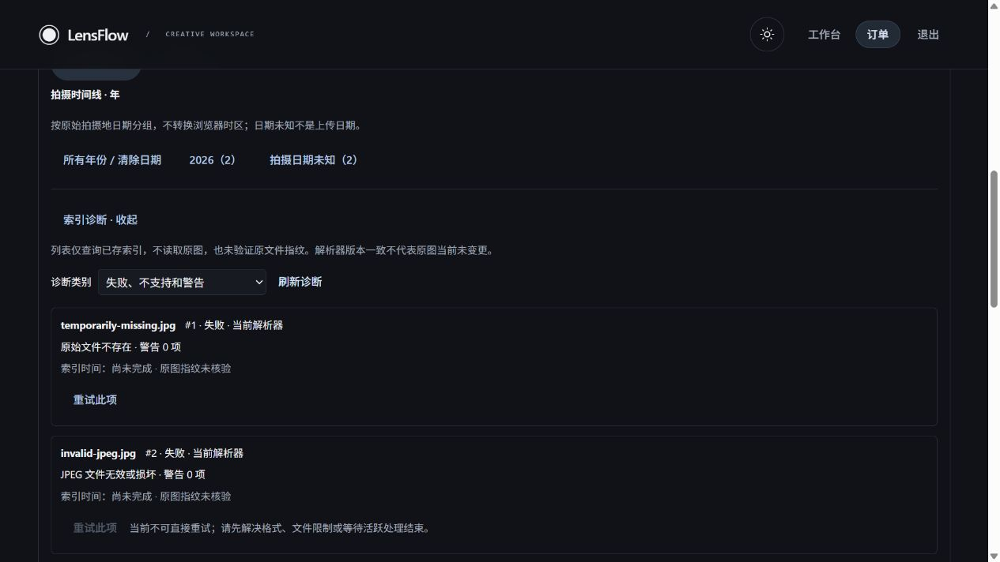
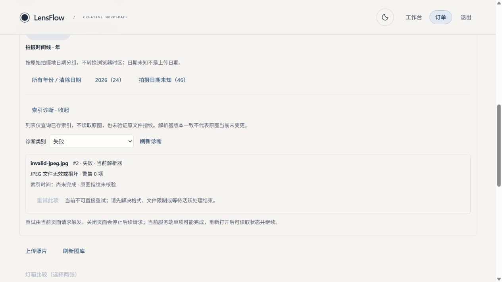

# LensFlow P3-C3：DAM 可靠性加固与可恢复元数据索引

日期：2026-10-18，Asia/Shanghai。

## 1. 简明结论

本阶段已实现租约发布加固、注释批处理锁顺序、受保护的诊断 API、摄影师端诊断与单项重试、Schema readiness、PostgreSQL 隔离测试入口，以及来源明确的解析兼容回归。实际验证使用临时 SQLite、真实 JPEG、独立操作系统进程、真实 FastAPI HTTP 和浏览器。

**真实 PostgreSQL 验收未完成。** 当前机器没有 PostgreSQL/Docker 可执行文件或服务，没有专用测试连接，当前虚拟环境也没有 psycopg2。没有安装数据库服务器，没有连接或迁移共享数据库。PostgreSQL 测试基础设施已写入，但真实迁移、锁竞争、死锁、进程恢复及 EXPLAIN ANALYZE 仍需在专用 PostgreSQL 环境执行。

不能把此交付称为已经通过生产验收。下文将实现、实际验证和环境缺口分别记录。没有进入 P3-C4。

## 2. 审计与基线

检查了 B1/B2/B3/C1/C2 报告及实际上传、LocalStorage、解析器、租约、注释 CAS、游标、查询、Alembic、前端 query key 和测试隔离代码。工作分支为 `design-system`；开始时存在大量前序阶段未提交/未跟踪内容，未执行 reset、clean 或提交。

开始前保存了 303 份代码/资源指纹；另保留 Git 状态和开发数据库只读版本核对。真实开发库为 `backend/storage_local/lensflow.db`，版本仍为 `5e0b2fd720d3`。

本轮真实基线：

| 检查 | 结果 |
| --- | --- |
| 后端完整 pytest | 441 passed，1 skipped |
| 前端完整 Vitest | 315 passed |
| 现有 C1 专项 | 50 passed |

证据见同目录 `image-processing-p3-c3/` 中的 baseline XML。测试数据库、uploads、后台 SessionLocal 和通知继续使用既有 fail-closed fixture；不会对实际开发库执行 create_all/drop_all。

## 3. 修改文件

### 生产后端

| 文件 | 修改 |
| --- | --- |
| `backend/app/services/metadata_index.py` | claim revision 条件；publish token/revision/state/parser/expiry 条件；安全的数据库错误分类 |
| `backend/app/services/photo_annotation.py` | 按 photo_id 排序获得写锁，保持调用者响应顺序与原 CAS 语义 |
| `backend/app/services/metadata_issues.py`（新增） | SQL 诊断、白名单、签名游标、重试建议、身份说明 |
| `backend/app/schemas/metadata_index.py` | 新增 IndexIssue/IndexIssues，复用 UTC 序列化 |
| `backend/app/api/v1/metadata_index.py` | issues 路由、私有错误处理、缺表的明确 503 |
| `backend/app/services/schema_readiness.py`（新增） | 只读检查必要表、列与迁移版本 |
| `backend/app/main.py` | 启动警告与 `/ready`，保留 `/health` 合同 |
| `backend/app/core/config.py` | 使用 URL.create 编码数据库凭证；有限连接池配置 |
| `backend/app/core/database.py` | 仅 PG 使用 pre_ping、池大小/溢出/等待和连接超时 |
| `backend/alembic/env.py` | 转义 ConfigParser 中 URL 的 `%`，未改迁移历史 |
| `backend/pyproject.toml` | 声明可选 postgres extra：psycopg2-binary |
| `backend/.env.example` | 记录新增池参数和独立迁移要求 |
| `docker-compose.yml` | 删除 backend 启动命令中的自动迁移；增加 `/ready` 健康检查 |

### 测试基础设施与回归

- `backend/scripts/postgres_sandbox.py`、`test_postgres.py`。
- `backend/tests/postgres/`：独立 pytest 配置、归属防护、迁移、并发、可终止进程 worker。
- `backend/tests/test_metadata_reliability.py`：实际 SQLite 子进程竞争、五个 kill 切点、租约发布条件、错误分类和注释锁顺序。
- `backend/tests/test_metadata_issues.py`：权限、分页、状态/隐私、无原图读取、URL 配置与 readiness。
- `backend/tests/test_metadata_compatibility.py`、`backend/tests/fixtures/metadata-manifest.json`。
- `docs/image-processing-p3-c3-camera-corpus.md`：来源分类及后续授权原片引入流程。

### 前端

- 新增 `frontend/src/components/photo-library/MetadataIssues.tsx`、`MetadataIssues.test.tsx`。
- 修改 `frontend/src/api/metadataIndex.ts`、`metadataIndex.test.ts`：严格白名单 DTO、诊断/单项重试/显式警告读取；补强旧批次结果适配。
- 窄集成 `MetadataTools.tsx`、局部 `metadata-tools.css`。
- `MetadataTools.test.tsx` 的 resetQueries 断言改为定位 catalog predicate，允许新增诊断查询先失效；保留原有作用域与 thumbnail 断言。

无新增路由、数据库表或迁移版本。没有修改生产 C1 parser、像素编辑算法、Photo/Order/RetouchVersion/Delivery 模型、缩略图配方、首页粒子或全局设计系统。

## 4. PostgreSQL 环境与测试入口

### 环境发现

未发现 docker、psql、postgres、pg_ctl，未发现 PostgreSQL/Docker Windows 服务；常用本地端口未发现对应服务，没有显式 PG 测试 DSN。仓库原有 Compose 的 postgres:16-alpine 使用持久业务卷，不当作一次性测试环境复用。

Dockerfile 原本已经安装 psycopg2-binary；本轮为普通 Python 安装补了可选 extra，没有在本机安装服务器或假设任意可达 PG 可销毁。

### 隔离规则

`scripts/test_postgres.py` 只有在显式配置专用 loopback 管理连接和创建确认值后，才创建新的随机 `lensflow_test_<32hex>` 数据库。不接受已有业务数据库作为测试目标。

每次 schema 操作和清理前还核对数据库 OID、owner、current_user 及随机数据库 comment nonce，不能只凭名字含 test 判定安全。CREATE 不使用 IF NOT EXISTS；清理只能针对这次创建且归属仍匹配的数据库。连接采用 NullPool、有限 connect/statement/lock timeout。

PG suite 必须在独立进程中使用 `--confcutdir=tests/postgres`，不继承强制 SQLite 的旧 conftest；禁止仅设置 DB_TYPE 就把 SQLite suite 当 PG suite 使用。PG suite 不调用 metadata.create_all/drop_all。

本轮实际运行：

```powershell
# 在 backend 目录
& ../.agentwork/design-system/p5-venv/Scripts/python.exe scripts/test_postgres.py -- -q --junitxml=../.agentwork/p3-c3/postgres.xml
```

结果：**12 项纯防护测试 passed，13 项 PostgreSQL 用例 skipped**，原因明确为没有显式一次性 PostgreSQL 环境。这 12 项不是数据库集成通过。

另实际运行 `--require-postgres -- -q`，返回 **exit 2**，以便 CI 缺少环境时明确失败，不通过 skip 伪装验收成功。

### 专用 CI/测试机命令

在已授权的一次性 PostgreSQL 实例上配置测试管理角色；连接只用于创建新的随机测试库，不填业务库凭证。示意变量不含真实密码：

```powershell
python -m pip install -e '.[dev,postgres]'
$env:LENSFLOW_PG_TEST_ADMIN_DSN = '<dedicated loopback postgresql+psycopg2 DSN for postgres/template1>'
$env:LENSFLOW_PG_TEST_ALLOW_CREATE = 'CREATE_NEW_DISPOSABLE_DATABASES_ONLY'
python scripts/test_postgres.py --require-postgres -- -q
```

真实 PG 执行、连接池压力和 provisioning 故障下清理行为尚待该环境验证。入口的静态/模拟归属防护测试不能替代真实 PG 清理验收。

## 5. Alembic 与数据库一致性

代码 head 未变：`d5f7a9c1e323`。

完整链为：

`base → 5e0b2fd720d3 → f3a1c2d4e5b6 → b2d4a6c8e010 → c4e6a8b0d212 → d5f7a9c1e323`。

实际临时 SQLite 环境重新执行了 base→head，构建实际应用并通过 `/ready`；完整回归也重新执行了原有升级/降级、约束、CASCADE 和业务内容不变测试。没有通过 stamp 伪造升级成功。

PG 测试文件包含完整链、历史版本带 Photo 数据升级、派生表降级后重建、唯一/FK/数值约束及 SQLAlchemy CRUD；这些用例均因环境缺失而跳过。不能声称 PostgreSQL 已验证。

新 readiness 是运维检查，不是替代迁移或完整约束审计。它检查必要表、关键列和当前要求 revision。未来增加迁移时需同步所需版本。实际开发库保持历史 revision，未自动升级。

## 6. CAS、事务及锁顺序

### 索引认领与发布

claim 的条件 UPDATE 同时检查已有 revision 和租约可认领状态。成功后保存实际认领 revision；发布必须同时满足：

1. photo_id 匹配；
2. lease_token 匹配；
3. revision 匹配认领时版本；
4. 状态仍为 pending；
5. parser_version 仍为该 worker 的版本；
6. lease_expires_at 晚于当前 UTC 时间。

因此即使没有第二个 worker 接管，处理超时的旧 worker 也不能发布成功；有新 owner/version 时更不能覆盖。条件失败保留可恢复状态，返回 busy/pending 等实际结果，不伪造成功。

没有在读取原文件/解析期间持有整批事务。发布只有短 UPDATE/commit。删除竞争不创建新 Photo，FK 删除派生行；原有相关测试完整回归。

### 注释批处理

输入为相反顺序的批次可能形成相反加锁顺序。本轮只把写入顺序固定为 photo_id 升序，响应仍按调用者输入顺序返回。原 expected_revision、首次创建唯一键竞争、部分冲突和意外错误整批 rollback 规则未改。

实际 SQLite 独立进程验证：同一照片认领仅一个成功；注释首次创建和相同期望 revision 更新各只有一个成功写入。SQLite 不是 PostgreSQL 并发证明。PG 对应独立连接/进程测试已编写但未执行；不同照片压力、实际死锁与池耗尽尚无 PG 测量。

## 7. 真实进程中断与恢复

`test_metadata_reliability.py` 使用 spawn 创建独立应用进程，在事件切点调用操作系统 terminate，并等待/回收子进程，验证非零退出状态，不是异常模拟。

| 切点 | 中断后要求 |
| --- | --- |
| claim commit 前 | 没有有效认领；SQLite SAVEPOINT 可能留下无租约初始 pending 行，不能留下已提交有效租约或成功状态 |
| claim commit 后 | pending，未发布；到期后可继续 |
| 解析中 | 在 JPEG 分段解析进入规范化管线的受控切点终止，未发布 |
| publish commit 前 | 结果 UPDATE 未提交，终止后 rollback，保留先前 pending 认领 |
| publish commit 后、返回前 | indexed 已持久化；响应丢失后再次调用可校验源字节并复用 |

恢复验证包含唯一行、真实 JPEG hash、Photo 内容未变，以及旧 token/revision/state/parser/expired 不能发布。测试仅对一次性库中的租约推进到过期，不等待真实 120 秒；没有把缩短测试等待称为生产超时已量测。

没有续租线程或自主 worker。过期 worker 仍可能被不可中断的本地文件系统调用阻塞；它最终返回时不得发布。每进程 C1/C2 共用两个处理槽，多 worker 总量随 worker 数增加，不能描述成全系统仅两个。

## 8. 错误分类与日志

数据库异常 rollback 后只返回固定代码、固定消息，不返回 SQL、参数、文件路径、堆栈或认证内容。

| 条件 | 代码 |
| --- | --- |
| PG 40P01 | INDEX_DATABASE_DEADLOCK |
| PG 40001 | INDEX_DATABASE_RETRY |
| PG 55P03 / 57014、池等待超时或锁繁忙 | INDEX_DATABASE_BUSY |
| 缺表 PG 42P01 / SQLite no such table | SCHEMA_NOT_READY |
| 其它数据库故障 | INDEX_DATABASE_ERROR |

SQLSTATE 映射由故障注入验证，**未触发真实 PostgreSQL deadlock**。日志只记录固定分类代码，不打印 driver 原文。SQLite 锁繁忙保留既有忙错误语义；其它未知错误不都被误标为 busy。

损坏 JPEG、超限文件、格式不支持及存储缺失仍使用既有照片级状态/错误码。retryable 是诊断建议，不代替身份鉴权，也没有悄悄禁止原有授权 refresh API。聚合“重试失败项”保持 C2 合同，可能重试尚未修复的永久问题；单项 UI 会明确禁用这类直接重试并说明需先修复。

## 9. 诊断 API

```http
GET /api/v1/orders/{order_id}/metadata-index/issues?status=failed,unsupported,warnings&limit=20
Authorization: Bearer <token>
```

鉴权：摄影师角色 + 持久化订单归属；客户、其他摄影师、跨订单在读取诊断前被拒绝。成功与错误均有 private/no-store、Pragma、Vary Authorization 和 nosniff。

- status：failed / unsupported / warnings / pending，允许不重复 CSV；默认前三类。
- limit：默认 20，1–50；前端使用 20。
- cursor：最多 320 字符，HMAC 独立 purpose，绑定用户、订单、规范化类别、位置和 Photo.id 上界。
- Photo.id 升序分页；问题成员是实时集合，索引变化后前端重建序列，不声称 MVCC 快照。

响应结构：

```json
{
  "items": [{
    "photo_id": 1,
    "filename": "temporarily-missing.jpg",
    "index_status": "failed",
    "error_code": "NOT_FOUND",
    "warning_count": 0,
    "indexed_at": null,
    "retryable": true,
    "current_parser_version": "c1-v1.index-v1",
    "parser_version": "c1-v1.index-v1",
    "identity_state": "current_parser",
    "source_verified": false
  }],
  "next_cursor": null
}
```

上例省略其它照片，是形状示例，真实初始响应保存在 `http-initial.json`。

列表不读原图，不返回 storage_key、源哈希、GPS、序列号、MakerNote/XMP 或原始异常。文件名只保留 basename 并去除控制字符。identity_state 仅说明 parser 匹配/旧版本/无索引，**不是实际源哈希当前有效的证明**；source_verified 始终 false。

pending 包括无索引行、旧 parser、pending 状态；有效租约时不可直接重试，过期时显示 LEASE_EXPIRED。warning_count 仍只保存数量，未伪造具体警告。详细警告通过显式单项 GET 既有 C1 metadata API 读取，前端只保留固定安全标识，未知字符串计数但不展示原文。

## 10. 摄影师界面

在现有 MetadataTools 内增加默认折叠的诊断区，没有新 dashboard/路由：

- 首次展开才加载；按失败、不支持、警告、待处理切换，显示明确空/加载/错误状态。
- 单项重试最多一个并发操作，失败提示局部保留；其它照片仍可继续操作。
- 显式读取某一项警告，避免每卡请求原图。
- 取消信号、用户/订单/query key 隔离；卸载中止前端操作，不能让旧订单响应进入新订单。
- generation 变更重建问题分页，索引统计与原过滤/时间线机制继续协作。
- 不清空 ThumbnailPool，不整体刷新缩略图 Blob；沿用原图库选择与查看器/编辑器/Light Table。
- 局部 CSS 使用既有 token，实际浏览器验证深浅两种主题。

## 11. 相机样本与兼容回归

来源清单及完整说明分别见：

- `backend/tests/fixtures/metadata-manifest.json`
- `docs/image-processing-p3-c3-camera-corpus.md`

真实摄影源图为既有 `grace_hopper.jpg`，Pillow 独立检查无 EXIF/ICC，相机来源未知。C1/C2 中带 Canon/EOS 标签的文件都是注入构造数据。真实 Canon/Nikon/Sony 相机原片各 **0 份已核实**，未下载随机个人照片补数。

新增 33 项覆盖：ICC 多分片与异常、APP13/IIM 与 Latin-1/UTF-8、XMP namespace 和重复包、DTD/XXE、全 8 EXIF Orientation 的 Pillow 对照、日期/±14h/9 位子秒、缺失镜头、源指纹/mtime 和读取隔离。未改生产 parser。

实际运行原 C1 50 项和新增 33 项合并回归，83 passed。合成安全回归不能作为真实厂商兼容性证明。

## 12. SQL 性能与计划

在自建临时 SQLite 中分别准备 1,000 和 10,000 条元数据分布；目标订单分别为 900/9,000 张，其余位于无权订单。包含缺失注释、缺失索引、pending/failed/unsupported、多设备、多镜头、不同 ISO/光圈、重复/缺失拍摄日期。

纯 SQL 测量每项 10 次，不含 HTTP/auth，不读取 JPEG，不是索引吞吐。

| 操作 | SQL/调用 | 1k 中位数 ms | 10k 中位数 ms |
| --- | ---: | ---: | ---: |
| catalog | 2 | 3.167 | 2.875 |
| facets | 5 | 4.607 | 42.531 |
| year timeline | 4 | 3.848 | 22.562 |
| month timeline | 4 | 4.145 | 21.829 |
| day timeline | 4 | 4.515 | 24.685 |
| completeness | 1 | 1.428 | 7.400 |
| issues | 2 | 1.625 | 1.785 |

完整 SQL、实际 SQLite EXPLAIN QUERY PLAN、返回规模、中位数和最大值保存在 `performance.json`。已有订单索引和 photo_id 唯一索引承担 JOIN；部分聚合使用临时分组/排序。未仅因字段出现就添加新索引。

这是本机合成分布与缓存条件下的证据，不能外推生产 SLA，也不是 PostgreSQL EXPLAIN ANALYZE。PG 计划、临时排序、锁等待和生产规模调优仍未验收。

## 13. 真实 HTTP、浏览器和后端重启

使用独立 FastAPI 8053、Vite 4253、临时 SQLite/uploads。实际登录摄影师，实际 multipart 上传无 EXIF 原照与已知 EXIF 构造 JPEG，Pillow 独立核对值和 SHA；初始订单 70 条，上传后 72 条，另有其他摄影师订单。

实际检查包括：

1. 初始 4 indexed / 65 pending / 2 failed / 1 unsupported；诊断显示缺失、损坏、不支持和警告。
2. 仅在临时测试源上模拟文件短暂缺失，原样补回后，浏览器单项重试成功；未触碰实际用户上传目录。
3. 点击一项警告读到 `xmp.invalid_or_unsafe_packet`，未将数量伪造为标识。
4. 完成客户端续批，保留 1 个损坏样本和 1 个不支持样本作为真实未成功状态。
5. 实际终止并新建后端操作系统进程。第一次小订单续批已在 kill 前完成，只证明已提交结果跨重启保留，不能声称浏览器捕获了在途解析中断。
6. 为可重复的恢复验收，仅把 40 条派生索引版本改成旧测试版本，再次实际 kill/restart；浏览器 reload 看到 30 indexed / 40 pending，显式继续后恢复 70 indexed / 0 pending。源文件与业务表不变。这是旧版本重建恢复，不冒充真实生产 parser 升级。
7. 浏览器验证深色故障列表、浅色失败分类、pending 空状态、警告分页至 photo 68。查看器/Light Table 的本轮证据来自完整 Vitest 回归，未重复宣称它们的真实浏览器验收。
8. 真实 HTTP 验证客户/跨订单被拒绝，原客户 catalog 正常，元数据筛选、facets、timeline 返回成功；诊断 limit=3 分页无重复。

最终为 72 张：70 indexed、0 pending、1 failed、1 unsupported。没有把“处理完所有请求”表述为“所有照片成功”。





另有 `restart-pending-dark.png`、`backend-restart.json`、`restart-fixture.json`、`http-initial.json`、`http-final.json`。全页长截图超出当前捕获能力后改用实际视口截图，没有拼接或伪造画面。

## 14. 测试命令与结果

均在现有 Python venv / frontend node_modules 中执行；无新增大型依赖。准确的完整命令列表另存于 `image-processing-p3-c3/commands.txt`。项目现有 `npm run lint` 使用 oxlint；未安装或声称运行 ESLint。

```powershell
# backend
& ../.agentwork/design-system/p5-venv/Scripts/python.exe -m pytest -q --tb=short --junitxml=../.agentwork/p3-c3/backend-final.xml
& ../.agentwork/design-system/p5-venv/Scripts/python.exe -m pytest -q tests/test_metadata_issues.py tests/test_metadata_reliability.py --tb=short
& ../.agentwork/design-system/p5-venv/Scripts/python.exe -m pytest -q tests/test_metadata_reliability.py tests/test_metadata_index_edges.py --tb=short --junitxml=../.agentwork/p3-c3/reliability-final.xml
& ../.agentwork/design-system/p5-venv/Scripts/python.exe -m pytest -q tests/test_photo_metadata.py tests/test_metadata_compatibility.py
# Ruff：仅本阶段修改/新增 Python 文件，准确列表见报告文件清单和命令记录
python -m ruff check <modified Python files>

# frontend
npx --no-install vitest run --reporter=junit --outputFile=../.agentwork/p3-c3/frontend-full.xml
npx --no-install vitest run src/components/photo-library/MetadataIssues.test.tsx src/components/photo-library/MetadataTools.test.tsx src/api/metadataIndex.test.ts
npx --no-install tsc -b
npm run build
npm run lint
```

| 检查 | 结果 |
| --- | --- |
| 最终完整后端 | 526 passed / 14 skipped / 13 warnings，543.64 秒 |
| 前一次完整后端 | 524 passed / 14 skipped / 13 warnings |
| C1 + 新兼容回归 | 83 passed |
| 新 issues + reliability 早期目标 | 37 passed；后续补充分类/锁顺序另行回归 |
| 最终可靠性与 C2 边界目标 | 35 passed，68.43 秒 |
| PG 独立入口 | 12 防护 passed / 13 PG skipped |
| require-postgres 门禁 | exit 2，环境不足，符合 fail-closed 要求 |
| 前端完整 | 328 passed |
| 前端目标 | 22 passed |
| TypeScript / build | exit 0 / exit 0，253 modules |
| lint | exit 0，4 条既有警告 |
| Ruff 修改文件检查 | passed |

后端跳过为 13 项真实 PG 用例及 1 项 Windows 符号链接权限；既有警告为 Starlette/httpx 与 Alembic path_separator。前端保留 DarkroomVideoBackground 两条、ParticlePortrait 一条、AssetGrid 一条既有 lint 警告；没有为消除它们而修改这些受保护模块。

执行中确有失败：新增诊断 query reset 先于 catalog reset，使旧测试“第一个 reset 必有 predicate”的假设失效。已改为寻找并验证真正的 catalog predicate，保留隔离/thumbnail 断言后目标 22 项通过。Ruff 首轮发现新文件长行和既有 main 导入位置，限定文件整理后通过。早期测试控制器的退出顺序也在执行浏览器验收前修正，首个未使用沙箱已确认清理。未把失败命令记作通过。

## 15. 数据保护与清理

真实 HTTP 比对了 8 份临时原始文件 SHA 和 19 个非索引表完整内容（含 Alembic 版本及 18 个业务表）；原图、Photo/Order、人工注释、草稿、客户选片、修图与交付未变。

独立进程 kill 测试另外核对了真实 JPEG 与 Photo 内容。开始快照与最终指纹检查保护生产 parser、像素算法、业务模型、迁移版本文件、缩略图、首页/设计系统及真实开发存储；预期修改逐文件列出，未把预期更改伪称未改。

清理结果与最终指纹保存在 `cleanup.json`、`immutability.json`。本阶段创建的后端/Vite 进程和浏览器页已停止；解析性能沙箱和 pytest 沙箱正常清理。最后浏览器沙箱的自动清理因控制器 SQLite 连接仍被引用而失败，控制器已改为 `contextlib.closing`。进程退出后，对该已核对归属的临时目录执行删除被自动审批拒绝，工具仅返回 `blocked by policy`，未给出更具体原因；没有改用其它方式绕过。

因此保留 `C:\Users\Chase\AppData\Local\Temp\lensflow-p3c3-browser-qwvwssns`，当时仅剩 `browser.sqlite`。这不是已清理成功。实际开发数据库没有迁移；没有清理前序任务遗留目录或用户文件。

## 16. 部署与运行要求

1. **迁移独立于启动。** Compose 现在不再运行 `alembic upgrade head`。发布前备份、确认目标和 revision，在已审查的维护步骤执行迁移；本轮未对真实库执行该步骤。
2. `/health` 保持旧 liveness 响应；`/ready` 缺表/列/所需版本时 503。Compose healthcheck 使用 `/ready`。启动只告警，不创建表或修改版本。
3. 当前要求 head 为 d5；真实开发库还在 5e0。不能只创建最后一张表或 stamp，必须检查完整迁移链。
4. sync SQLAlchemy 使用 psycopg2。普通安装需 postgres extra；现有 Dockerfile 已安装该驱动，但本轮未构建/运行 Docker 容器。
5. 默认 PG 每 worker pool_size=5、max_overflow=5、pool_timeout=10s、connect_timeout=5s、pre_ping=true。按数据库连接上限和 worker 数统一预算；这些是配置界限，不是已验证的 PG 负载容量。
6. parser 每 worker 两槽，lease 120s，batch 最多 10、文件间 1.5s 软预算，读源字节仍受既有 20 MiB 配置约束。没有新增自主后台处理或定时续租。
7. 生产设置 APP_DEBUG=false，避免 SQL echo 和通用调试输出；日志只暴露固定诊断分类。凭证仅从环境注入，特殊 URL 字符由 URL.create 编码。
8. 多主机 worker 保持时钟同步。capture-local 时间不当 UTC，indexed_at/租约使用 UTC；不能通过调大 lease 掩盖慢存储。
9. LocalStorage 使用私有挂载，原图目录不可作为公开静态目录。确保应用可只读原图并可写既有有界缩略图缓存，沿用 B1 根目录/权限约束。OBS 二进制读取仍不支持。
10. 解析使用内存缓冲，没有引入持久中间照片；已有缩略图缓存仍需按部署容量/权限配置。慢或不可中断文件系统调用没有硬取消保证。
11. 重试采用显式单项或客户端续批，关闭浏览器后不保证自动处理。异常提交后刷新状态再继续；已提交但响应丢失的结果可校验并复用。
12. 开放 PG 发布前，必须执行专用 PG harness 和真实 API/浏览器验收，并检查迁移/死锁/回收/连接池/查询计划；当前环境的 skip 不能代替这道门禁。

## 17. 交付状态及下一阶段

### 已实现并实际验证

SQLite 安全租约/CAS、独立进程竞争、五阶段真实 kill/恢复、源文件不变、诊断权限/分页/脱敏、深浅 UI 与单项重试、实际后端重启后的显式续批、解析兼容回归、1k/10k SQLite 查询计划、非破坏性 readiness 和自动化回归。

### 已实现但缺少必需环境验收

PostgreSQL 一次性数据库 harness、完整迁移/历史升级/约束/CRUD、PG 独立进程竞争与中断恢复用例。URL 特殊字符轮转测试通过不代表实际 PG 已连接。

### 阻塞与未完成

真实 PG 服务器/驱动/专用测试配置缺失；未执行真实 PG SQL、EXPLAIN ANALYZE、死锁/锁等待/连接池压力、真实 PG API/浏览器。真实 Canon/Nikon/Sony 原片授权语料缺失。Safari、物理手机与多主机部署未独立验收。一个只含测试 SQLite 的临时目录因自动审批拒绝删除而保留，路径见清理章节。

### 本阶段未实现

新队列/后台 daemon、OBS 改造、RAW/DNG、元数据编辑、XMP sidecar、AI 相似/人脸、像素算法或交付流程修改。

建议下一阶段先关闭 PG 验收缺口与真实相机语料缺口，再依据真实查询计划评估更大订单和索引调度。P3-C4 的任何编辑、sidecar 或 AI 功能均未开始。
