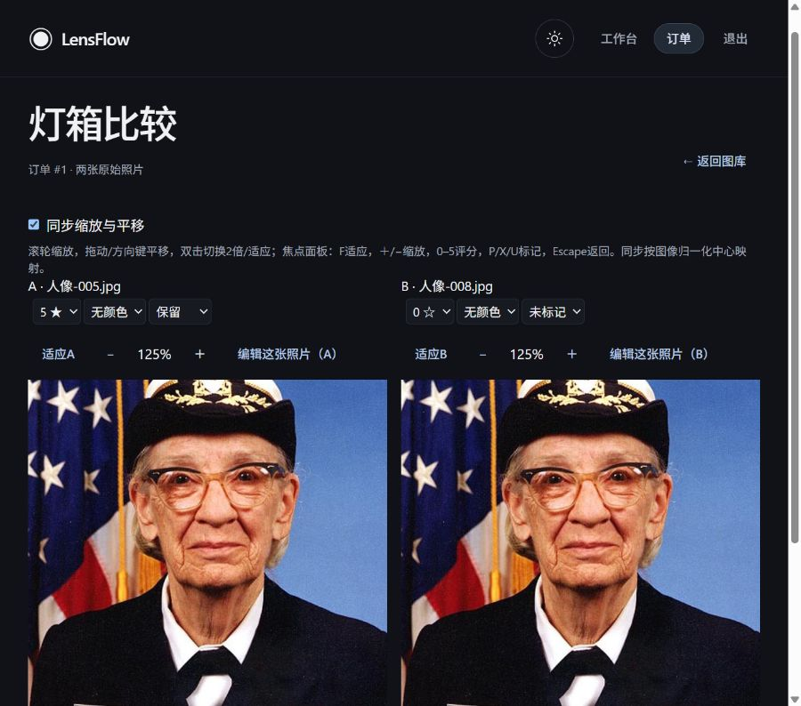
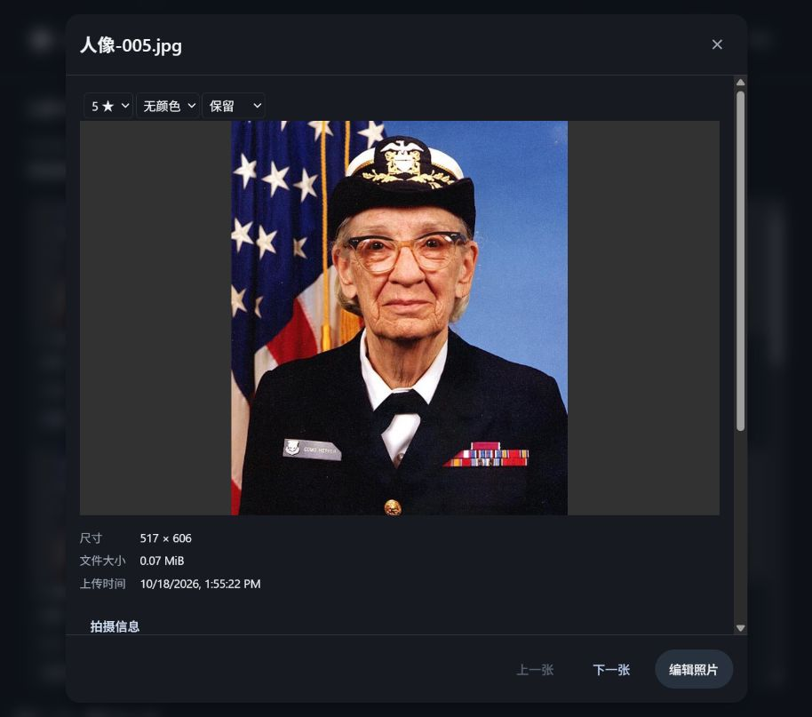
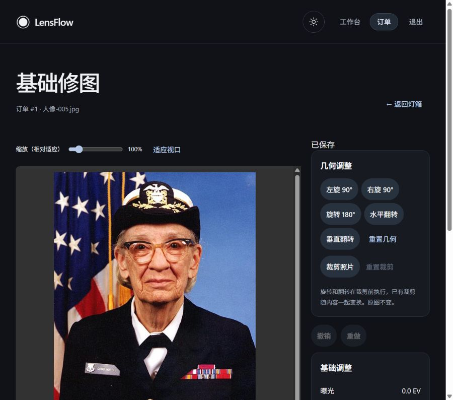
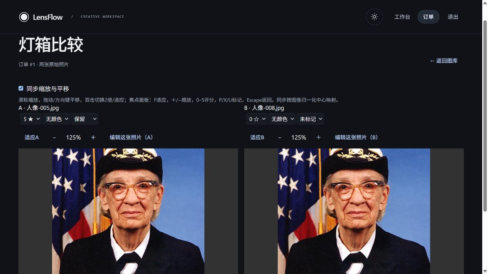

# LensFlow P3-D1：真实 PostgreSQL 集成、迁移验证与部署准备

日期：2026-10-18。工作分支：`design-system`。

## 1. 简明结论

本阶段已实际连接本机 PostgreSQL，执行真实 Alembic 迁移、独立进程竞争和中断恢复、SQL 查询、连接池与锁故障、真实 TCP HTTP 及浏览器流程。发现并修复了一项真实 PostgreSQL 时间戳缺陷：应用原有不带时区的时间列在上海时区会话中写入、随后按 UTC 返回，造成约 8 小时偏移。

修复只为应用物理连接设置 UTC；不改变服务器全局时区，不转换 EXIF 的拍摄地时间。不新增产品功能、不新增迁移、不修改首页粒子、设计系统、像素算法或业务模型。

本机环境在验证期间发生变化：原 PostgreSQL 18.6 / 5432 服务及 `postgres.exe` 被移除，18 的原数据目录仍存在；随后发现 PostgreSQL 14.24 / 5433 正在运行。按照用户“自行配置环境”的补充要求，使用当前可用的 14 环境补充兼容验证，只创建新的随机测试数据库，没有重建集群或改动已有数据库。

最终结果汇总由本目录 JUnit、日志和 JSON 产物提供。本文明确区分数据库测试、纯防护测试、SQLite、HTTP 和浏览器证据。

| 验证项 | 实际结果 |
| --- | --- |
| PostgreSQL 18.6 严格入口 | **101 passed、0 skipped**，102.25 秒；其中 15 项纯防护、86 项真实 PostgreSQL |
| PostgreSQL 14.24 严格入口 | **101 passed、0 skipped**，174.21 秒；其中 15 项纯防护、86 项真实 PostgreSQL |
| 最终完整 SQLite 回归 | **529 passed、87 skipped、0 failures/errors**；完整 616 节点、34 文件，四组总墙钟 331.17 秒 |
| 较早完整 SQLite 回归 | 528 passed、86 skipped、13 warnings，528.45 秒 |
| SQLite 最终防护/URL 专项 | 16 passed |
| 前端完整 Vitest | **328 passed / 54 files**，72.64 秒 |
| TypeScript / Vite build / oxlint | 通过；oxlint 保留 4 条既有警告 |
| Ruff：本阶段 9 个 Python 文件 | 通过 |
| PostgreSQL 18 真实 HTTP | 完成认证、真实上传、预览、元数据、索引、过滤、CAS、全尺寸导出和 SHA 检查 |
| PostgreSQL 18 真实浏览器 | 图库、筛选、时间线、诊断、评分、查看器、灯箱、编辑器；UTC 修复后再次核验核心路径 |
| PostgreSQL 14 真实 HTTP / 浏览器 | 独立重新执行同样闭环及页面路径，独立截图与 JSON 存于 `postgres14/` |

本阶段验证的是本机数据库集成及部署前置条件。Docker、云数据库、备份恢复演练、多主机和真实厂商相机语料仍有独立验收要求，不能据此宣称生产环境已经部署完成。

## 2. 审计依据与历史事实核对

已读取 B1、B2、B3、C1、C2、C3 报告，核对现有路由、照片授权、Storage、同步 SQLAlchemy、Alembic、CAS、租约、查询与测试隔离实现。

- C3 报告记录的 526 后端通过 / 14 跳过、328 前端通过是历史结果。本轮有新增测试，使用本轮结果单独计数。
- 代码迁移链确为 `base → 5e0b2fd720d3 → f3a1c2d4e5b6 → b2d4a6c8e010 → c4e6a8b0d212 → d5f7a9c1e323`。
- 真实开发 SQLite 仍在 `5e0b2fd720d3`，只读检查，没有升级。
- 应用使用 `settings.sync_database_url`、同步 SQLAlchemy / psycopg2；配置中的 asyncpg URL 不是本轮实际数据库执行路径。
- 启动和 `/ready` 不执行迁移；Compose 仍由独立迁移步骤负责应用 schema。
- 开始时已有 C3 未提交改动及未跟踪产物，全部保留，没有 reset、clean、提交或覆盖前序修改。

## 3. 实际环境和凭据

### PostgreSQL 18：最初完成验证的环境

| 项目 | 实际值 |
| --- | --- |
| 版本 | PostgreSQL 18.6，Windows x64 |
| 服务 | 初始 `postgresql-x64-18`，Running |
| TCP | 初始 `127.0.0.1:5432`，pg_isready accepting connections |
| 编码 | UTF8 |
| provider | `c` / libc |
| collation / ctype | `English_United States.936` / `English_United States.936` |
| datlocale | NULL |
| 服务器 TimeZone | `Asia/Shanghai` |
| 默认隔离级别 | read committed |
| max_connections | 100 |
| 本轮测试账户 | postgres，具备创建数据库权限；只用于隔离测试 |
| TCP 认证 | 实际 HBA 查询为 scram-sha-256 |

18 中 `current_setting('lc_collate', true)` / `lc_ctype` 返回 NULL，因此以 `pg_database` 的真实字段为准，未假设 default locale 的含义。数据库编码与 Windows locale 后缀是不同属性，不能把 `.936` 当作数据库存储编码。

### PostgreSQL 14：当前可用环境

已发现 `postgresql-x64-14` 服务和 `127.0.0.1:5433` 监听，`psql --version` 为 14.24，pg_isready accepting connections。实际查询同样为 UTF8、`English_United States.936`、`Asia/Shanghai`、read committed、max_connections=100。

14 没有 18 的所有数据库目录字段。环境采集脚本使用 `to_jsonb(pg_database)` 兼容读取可选字段；14 的 libc provider 为按该版本目录结构确认的兼容表示。没有为兼容环境报告修改应用 schema。

### 密码处理

密码由本机带遮蔽的输入框获取，只保留在临时协调进程内存，通过子进程环境传递。没有写入 `.env`、报告、截图、日志、Git 或命令行参数。URL 使用 SQLAlchemy `URL.create` 构建。

可复用测试入口新增 `--prompt-password`，使用本地终端 getpass。若 stdin 不是交互式终端，或 getpass 无法保证隐藏输入，返回 exit 2，不回退到明文输入。非交互式拒绝及不回显已实际验证，见 `secure-prompt.json`。没有显式配置时 `--require-postgres` 返回 exit 2，见 `strict-missing-config.json`。

项目 venv 原先缺少驱动；只在 `.agentwork/design-system/p5-venv` 中安装了已声明的可选依赖 `psycopg2-binary 2.9.13`，没有修改全局 Python，也没有新增框架依赖。

## 4. 数据库与存储隔离

复用 `backend/scripts/postgres_sandbox.py`：

1. 管理 DSN 只允许 loopback、psycopg2、postgres/template1 维护库，无任意 query override。
2. 需要显式 `CREATE_NEW_DISPOSABLE_DATABASES_ONLY` 确认；交互密码 flag 明确代表创建全新一次性数据库的测试流程。
3. 使用 `lensflow_test_<32位随机hex>`，`CREATE DATABASE ... TEMPLATE template0`，不使用 IF NOT EXISTS。
4. 保存数据库 OID、owner 和 64 位随机 nonce 注释；每次 schema 重建/清理前校验身份、当前角色及 nonce。名称前缀本身不能授权删除。
5. 清理只终止该数据库 OID 下的连接，再删除本次创建的数据库。
6. 新增拒绝目标 DSN query override，以及 `__enter__` 失败时进入同样受保护的清理流程。若无法证明身份，不猜测删除。
7. 连接 5 秒、语句 15 秒、锁 5 秒、idle-in-transaction 15 秒均有边界。专门竞争用例进一步设置更短本地超时。

15 项纯防护测试包含目标限制、显式授权、OID/owner/actor/nonce 不匹配、创建中途异常、清理身份不匹配时拒绝 DDL。这些结果没有被计入真实数据库用例数。

PG suite 使用独立 `tests/postgres/pytest.ini` 和 `--confcutdir=tests/postgres`，排除普通测试中会切换到 SQLite 的根 conftest。PG fixture 再次核对应用 engine 的方言和数据库名。实际跑的是 PostgreSQL，不是设置一个环境变量后继续使用 SQLite。

所有文件使用新建的 `lensflow-pgd1-*` / `lensflow-pg-integration-*` 临时目录，通知目标清空；后台分析通过同一隔离应用配置和 SessionLocal 执行。每个作业环境 JSON 记录真实随机数据库、OID、locale、临时目录，作业 result JSON 记录清理结果，不包含 DSN 或密码。

## 5. 实际迁移、约束和历史升级

通过真实 Alembic 执行，未使用 stamp 代替迁移：

- fresh base→head，实际 head 为 `d5f7a9c1e323`。
- 核对 users、orders、photos、deliveries、selection、retouch、draft、annotation、metadata index 表。
- metadata index 的唯一 photo_id、FK CASCADE、状态、hash、ISO、光圈等 CHECK 约束通过真实 PostgreSQL CRUD / IntegrityError 验证。
- 删除 Photo 后，annotation 和 metadata index 的数据库级 CASCADE 生效。
- 历史库先迁移到 `5e0b2fd720d3`，插入关联的用户、预约、订单、照片，保存业务行和旧列快照；升级后逐列一致，并用当前授权函数读取升级后的真实关联照片。
- metadata migration 降到 `c4e6a8b0d212` 后再升 head，Photo 与 annotation 行保持一致。

本轮没有迁移缺陷需要修订，没有修改任何历史 migration 文件，也没有创建新 revision。

需要明确的遗留结构：`Photo.order_id` 在原模型/初始 migration 中没有真正的 Order 外键；业务授权通过真实 Photo→Order 查询实现。本轮验证了该授权链，不能把它写成“已补齐数据库外键”。没有擅自重写旧业务表或扩大 D1 范围。

## 6. 真实 PostgreSQL 注释 CAS

- 两个独立 OS 进程竞争首次创建：恰好一方成功、一方 revision conflict。
- 两个进程对相同 expected_revision 更新：恰好一方成功，revision 只推进一次。
- 相反 photo_id 输入顺序的并发批处理：应用按 photo_id 获锁，响应仍保持调用方顺序；一批成功，另一批冲突，没有死锁或静默丢写。
- 部分 revision 冲突与注入异常的整批回滚分别验证；异常模拟结果没有充当真实锁竞争证据。
- 通过真实 TCP 流式请求，提交后主动丢弃响应 body，再 GET 确认 revision=2；以不确定的旧 revision 重放得到 HTTP 409。
- 所有私有写入仍要求真实订单摄影师身份；客户、其他摄影师和跨订单请求被拒绝。

## 7. metadata lease / CAS 和事务边界

真实 PG 验证：同一照片只有一个进程能 claim，有效租约阻止重复认领，过期租约可回收，旧 token/revision 不能发布到新租约。补充边界包括：

- 仅过期但没有第二个 worker 回收时，原 worker 仍不能发布。
- parser_version 在处理期间改变时，旧 worker 不能发布。
- Photo 在处理期间被删除时，不能恢复/重建派生行。
- JPEG 解析检查点断言 `Session.in_transaction()` 为 false，解析期间没有长期数据库事务。
- 缺 EXIF、optional metadata warning、失败/不支持、旧 parser、generation 和 bounded diagnostics 的真实 PG 查询语义通过。

生产默认租约仍为 120 秒；测试只推进自己测试行的过期时间，不修改真实策略，也没有加入 Python 全局锁充当数据库一致性保证。

## 8. 五种真实进程中断

独立 spawn worker 达到同步检查点后执行 OS terminate，再通过新连接读取和恢复：

| 终止位置 | 实际提交状态和恢复 |
| --- | --- |
| claim commit 前 | 未提交事务回滚，无 index 行；新 worker 可完成 |
| claim commit 后 | pending 租约持久化；测试中过期后可恢复 |
| JPEG parsing 中 | pending，解析事务未打开；可恢复 |
| publish commit 前 | 发布事务回滚，pending；可恢复 |
| publish commit 后、响应前 | indexed 持久化；再次处理可安全 reused |

每项均检查唯一派生行、源 JPEG SHA-256 和恢复后 indexed 状态。没有终止 PostgreSQL 服务或无关进程。

## 9. 查询、游标、中文和拍摄时间

复用既有 SQLite suite 中的独立预期值/断言，通过 PG fixture 运行相同应用查询合同：

- rating / rating_min、颜色、Pick/Reject 及组合。
- 相机/镜头精确过滤，ISO/焦距/光圈范围，capture-local 日期范围和未知日期。
- 六种排序、相同评分/时间戳的稳定 ID tie-breaker、全量分页、V1/V2/V3 兼容，以及跨用户/订单/过滤条件的签名游标拒绝。
- facets、年/月/日 timeline、未知日期计数、issues 有界分页、旧 parser 和索引完整性。
- 中文文件名 `人像_北京_é_📷.jpg`、Unicode 相机/镜头名称真实往返。
- 不带时区、+14:00、-12:00、跨 UTC 日边界和 9 位小数秒，在 UTC、上海、洛杉矶会话中仍保留拍摄地日期。

应用设备标准化使用 Python lower 和空白归一化；不是 PostgreSQL locale-dependent lower。现有不提供 filename 排序；六种 catalog 排序依靠数值/时间和唯一 ID，确定性不依赖中文词典序。facets 字符串展示排序遵循数据库 collation，不承诺不同服务器 locale 下相同的字典序，也未新增 Unicode 模糊匹配语义。

## 10. 发现并修复的 UTC 缺陷

实际 HTTP 证据 `timezone-before.json`：系统 UTC 时间约 `05:47Z`，注释 updated_at 却为 `13:47Z`。PostgreSQL 默认会话为上海时区，现有列是 timestamp without time zone；带时区写入经服务器转换后变成当地 naive time，DTO 又赋予 UTC。

在修复前新增真实 PG 回归，实际 **1 failed**，见 `timezone-red.xml`。随后在 `app/core/database.py` 为 PostgreSQL 的每个物理连接增加 connect listener：在 autocommit 下 `SET TIME ZONE 'UTC'`，恢复原 autocommit 状态。

这样 session rollback 不会撤销 UTC 设置，原 PGOPTIONS 的语句/锁超时仍保留。SQLite 分支不变；服务器/数据库默认时区不变；EXIF 原始 string/date 不变。

修复后时间戳回归和完整 PG suite 通过；HTTP 检查 updated_at 与实际 UTC 相差小于 5 秒；浏览器上传时间显示恢复正常，而拍摄时间仍为 `2026-01-02 00:30:00.123456789+14:00`。

如果其他旧环境已通过非 UTC session 写入过历史 naive timestamp，本次连接修复不会猜测或回写那些旧行。部署前应独立审计历史时间语义。

## 11. 连接池和真实数据库故障

应用现有默认：pool_size=5、max_overflow=5、pool_timeout=10 秒、connect_timeout=5 秒、pool_pre_ping=true，来自现有 Settings。

实际测试使用更小的独立池，最大 1 连接、overflow=0、等待 0.2 秒，验证耗尽后 TimeoutError、归还恢复。终止**本测试刚创建且 OID 验证一致**的空闲 backend，下一次 checkout 通过 pre_ping 恢复新连接，没有终止其他数据库或服务。

真实 SQLSTATE 与最终 18 测量：

| 场景 | SQLSTATE | 实际观测 |
| --- | --- | --- |
| statement_timeout=100ms、pg_sleep(0.5) | 57014 | 约 114.60ms 后取消，rollback 后可查询 |
| 行锁竞争、lock_timeout=100ms | 55P03 | 约 112.75ms 等待后失败，rollback 后可查询 |
| 两连接相反锁顺序形成死锁 | 40P01 | 一方失败，一方提交；失败连接 rollback 可用 |
| SERIALIZABLE 双连接读取后竞争更新 | 40001 | 一方提交，一方序列化失败；无静默丢写 |

固定安全错误映射返回可重试 503，不把 SQL、DSN、路径或原始异常作为 API detail。真实 HTTP 另发起 12 个并发 status 请求，全部 200。该小规模并发检查不是服务器级压力测试或生产 SLA。

## 12. PostgreSQL EXPLAIN ANALYZE

`scripts/benchmark_postgres.py` 要求具有有效 capability 的**全新空测试库**，运行真实 migrations。构造 1,000 / 10,000 Photo、多订单/用户、混合 annotation/status/device/date 分布；目标订单占 90%。这些是 SQL-only 合成元数据，未声称有 10,000 张独立照片，也不测 JPEG 吞吐量。

每项执行 5 次，SQLAlchemy 捕获实际 SELECT，再执行 `EXPLAIN (ANALYZE, BUFFERS, FORMAT JSON)`。原始产物记录 SQL、Planning Time、Execution Time、节点 Actual Rows/Loops、Rows Removed、索引/顺序扫描、排序、HashAggregate、buffers、临时读写块。应用耗时包含 ORM/序列化；EXPLAIN 耗时是另一轮服务器测量，不能直接等同或相加成 API 延迟。

PostgreSQL 18 最终应用调用中位数（ms）：

| 操作 | SQL 次数 | 1,000 记录 | 10,000 记录 |
| --- | ---: | ---: | ---: |
| metadata + rating + pick 过滤目录 | 2 | 3.278 | 9.101 |
| rating_desc | 2 | 2.816 | 7.332 |
| created_desc | 2 | 2.978 | 9.030 |
| camera/lens facets | 5 | 5.801 | 22.922 |
| timeline year | 4 | 6.454 | 27.632 |
| timeline month | 4 | 5.924 | 24.733 |
| timeline day | 4 | 6.055 | 23.629 |
| index completeness | 1 | 1.385 | 6.415 |
| issues page | 2 | 1.933 | 2.479 |

实际计划使用 camera_model、metadata photo_id、annotation owner 唯一索引、Photo 主键等，也有 Seq Scan / Hash Join / Sort / Aggregate。目标订单占九成时顺序扫描可能更合算，没有为消除 Seq Scan 强加索引。最终 18 的 18 组测量未发生临时磁盘溢写；详见 `performance.json` 和 `performance-summary.json`。

本轮没有足够证据支持新增索引，因此没有 index migration 或额外写放大。14 的相同基准单独保存在 `postgres14/`，不混用版本间的计划和数字。

14 在 10,000 记录下，过滤目录/评分降序/创建时间降序/facets/年/月/日时间线/completeness/issues 的中位数依次为 12.031 / 10.762 / 12.916 / 31.477 / 37.389 / 33.478 / 39.626 / 9.132 / 3.112ms，18 组测量同样无临时磁盘溢写。

## 13. readiness 和启动行为

在同一次性 PG 数据库按迁移阶段分别启动实际应用/TestClient：

- 空 schema：`/health` 200，`/ready` 503。
- 历史 `5e0b2fd720d3`：`/ready` 503。
- 完整 head：`/ready` 200。

每次比较启动前后 table 清单及 revision，证实 readiness/startup 不创建表、不升级版本。真实 TCP 服务的 health/ready 也为 200。未在现有用户数据库上制造缺表或旧版本条件。

## 14. 真实 HTTP

独立 uvicorn 子进程只绑定 `127.0.0.1:8054`，使用随机 PG sandbox、独立 LocalStorage、禁用通知。测试账号由现有模型/密码哈希流程 provision，再经真实 login API 认证。

完成：

1. 两张实际 multipart JPEG 上传，一张原始 Grace Hopper 照片、一张明确注入 EXIF 的构造变体。
2. 私有 thumbnail、真实 JPEG preview、C1 metadata。
3. SHA 和 Pillow 独立 EXIF 对照、逐批索引、完整性、issues、设备过滤、facets、timeline。
4. 未认证 401、跨订单/客户私有请求 403、客户普通 catalog 保持可用。
5. annotation 写入/409/提交后丢弃 body/读回/旧 revision 重放。
6. 12 个真实并发请求。
7. 全尺寸 JPEG export，实际解码 517×606。
8. 原始种子文件和上传文件的真实 SHA 对照，以及索引/导出前后全部 7 个源文件 SHA 一致。
9. 非空 customer selection 和 delivery 行及 retouch 表快照保持一致。

72 张订单记录复用少量真实 JPEG 及构造变体，最终 indexed=70、failed=1、unsupported=1、pending=0；其中两个异常为明确设置的无效/不支持样本。不得把这些计数误解为 72 张真实厂商原片。

## 15. 真实浏览器

使用实际 Vite 4254→FastAPI 8054→PostgreSQL 18，未使用 fixture 参数或 mock API：登录、真实图片网格、EOS 70D 过滤（23 张）、时间线年→月、诊断类别、Photo 5 的 5 星和 Pick、查看器 EXIF、两张原图 Light Table、同步缩放到 125%、保留过滤上下文进入编辑器。编辑器显示“已显示服务端校对结果”和“已保存”。

UTC 修复后重新登录并重走筛选、评分/标记、查看器、同步灯箱和编辑器路径。切换至当前 14.24 / 5433 后，又独立完成登录、真实图库、23 张相机筛选、年→月时间线、诊断、5 星/Pick、查看器元数据、同步 125% 灯箱及编辑器服务端校对。14 的独立证据为 `postgres14/browser.json` 和同目录四张截图，不以 18 的截图代替。

最终截图：







当前 PostgreSQL 14 的独立页面截图：



## 16. 本阶段修改文件

| 文件 | 改动 |
| --- | --- |
| `backend/app/core/database.py` | PostgreSQL 应用连接的 UTC session；生产代码唯一功能修复 |
| `backend/scripts/postgres_sandbox.py` | query override 拒绝；enter 中途失败的受保护清理 |
| `backend/scripts/test_postgres.py` | 本地隐藏密码输入、用户/端口参数、非交互式拒绝 |
| `backend/scripts/benchmark_postgres.py`（新） | fresh-owned-only 1k/10k SELECT 和真实执行计划测量 |
| `backend/scripts/verify_postgres_http.py`（新） | fresh-owned-only 真实 HTTP、可选有时限浏览器 fixture、源文件/业务保护 |
| `backend/tests/postgres/test_sandbox_guards.py` | 补充输入与清理 fail-closed 防护 |
| `backend/tests/postgres/test_migrations.py` | 关联历史业务数据的升级保护与升级后授权读取 |
| `backend/tests/postgres/test_queries.py`（新） | 将既有查询合同实际运行在 PostgreSQL；Unicode/本地拍摄时间 |
| `backend/tests/postgres/test_runtime.py`（新） | UTC、真实锁/死锁/序列化/连接池/晚发布/readiness |
| `docs/image-processing-p3-d1.md`、同名证据目录（新） | 报告、JUnit、日志、JSON 与截图 |

`.agentwork/p3-d1/` 为忽略的本地编排/只读快照，不是应用部署依赖，不保存密码。其他 dirty 文件来自前序阶段，不能把整个 git diff 当成本阶段改动。

## 17. 实际命令与证据

本轮 Python 均来自 `.agentwork/design-system/p5-venv/Scripts/python.exe`。完整输出保留在证据目录；以下为执行入口，不含密码：

```powershell
# backend：真实 PostgreSQL strict launcher（本轮通过内存 URL 提供配置）
python scripts/test_postgres.py --require-postgres -- -q -ra -o junit_family=legacy --junitxml=../docs/image-processing-p3-d1/postgres-final.xml

# 后续人工复现：在支持隐藏输入的本机终端执行
python scripts/test_postgres.py --prompt-password --pg-user postgres --pg-port 5433 --require-postgres -- -q -ra

# backend：普通隔离 SQLite，不能用它代替 PostgreSQL 结果
python -m pytest -q -ra --junitxml=../docs/image-processing-p3-d1/backend-sqlite.xml

# 最终完整 collection 按文件分为四个独立进程，原隔离 fixture 保持不变
# 具体四条命令、完整文件列表、616 个预期 nodeid 见 sqlite-partitions.json
python -m pytest -p no:cacheprovider -q -ra <该组完整文件列表> --junitxml=../docs/image-processing-p3-d1/sqlite-group-N.xml

# 必须由已验证的 fresh-owned launcher 子进程环境运行，不能指向业务库
python -m scripts.benchmark_postgres --output ../docs/image-processing-p3-d1/performance.json
python -m scripts.verify_postgres_http --output ../docs/image-processing-p3-d1 --port 8054

# frontend
npx --no-install vitest run --reporter=default --reporter=junit --outputFile.junit=../docs/image-processing-p3-d1/frontend.xml
npx --no-install tsc -b
npm run build
npm run lint
```

`ruff.log` 对应本阶段上述 9 个 Python 文件的明确列表。oxlint 4 条既有警告来自 DarkroomVideoBackground（2）、ParticlePortrait（1）、AssetGrid/TanStack Virtual（1），没有据此声称消除了既有警告。

最终 SQLite 分组先用 pytest collect-only 得到全部 616 个唯一 nodeid，再按完整文件分组；四组测试文件的并集等于全部 34 文件，最终 616 个 testcase 身份无重复。每个进程继续使用原根 conftest，新建独立 SQLite / 存储、通知隔离和开发目录哈希 guard；移除任何 PG capability，禁用共享 pytest cache，不更改算法、密码哈希或测试断言。四组分别为 122 passed/1 skipped、92 passed、120 passed、195 passed/86 skipped，退出码均为 0。

87 项普通回归跳过中，86 项是必须通过专用 PG launcher 才能运行的数据库用例，已在两个真实 PG 版本分别通过；另外 1 项是 Windows 符号链接权限。不是把这些普通运行中的 skip 视为 PG 成功。最终四个 SQLite 临时根及上传子目录均已随原 fixture 清理，路径和实际不存在的检查见 `sqlite-final-isolation-paths.json`。

执行过程中保留了失败证据：18 locale 采集不兼容的初次查询；HTTP helper 最初遗漏 SaveAnnotation 的必填字段；UTC 缺陷的红测；本地 strict 编排脚本初次 sys.path 错误；非交互式 getpass 的首次超时；中途环境切换。均未将失败记录写成通过。辅助脚本问题已修正后重新执行；真正应用修复是 UTC session。

## 18. 保护、清理与剩余限制

- `source-protection.json`：336 个非缓存文件快照中，332 个未变，4 个预期已有文件改变；首个 sandbox-only 防护改动发生在快照之前，另外显式列在允许修改清单中。无意外源码变化。
- frontend、首页粒子、全局设计系统、像素算法、业务模型和历史 migration 文件保持原样。
- 真实开发 SQLite SHA-256 为 `5c923e9d00775cc54a40d44e00c718146bc4858767fe5474fbadff5b757d1fef`，与开始时一致；revision 仍为 `5e0b2fd720d3`。
- 原始 JPEG SHA-256 为 `e1f57e98cf38076c0f9a058d74ffddf90f20453e436033784606b63c8ed2e49a`，与开始时一致。HTTP 和 crash 测试另核对自己的临时源文件。
- PostgreSQL 18 各作业 result 均记录其测试库及目录已清理，strict 子数据库清理后入口返回 0。随后 18 的程序被移除，最终维护库只读清单复核无法连接，因此**不能声称执行了 18 最终全库清单比较**；该失败保留在 `database-protection.json`。
- PostgreSQL 14 使用自己的开始/结束清单，不与 18 的数据库 OID 混比。`postgres14/database-protection.json` 实际记录原有 3 个数据库的身份、owner、编码和 locale 清单未变，剩余新数据库为 []。这是身份/配置清单比较，并非对用户业务库内容执行了全表哈希；已有库不作为任何写入目标。
- 后续两次串行 SQLite 追加回归因会话切换停在中途，不计通过；最终改为四组独立进程跑完同一完整 collection。中断遗留 `C:\Users\Chase\AppData\Local\Temp\lensflow-pytest-mfs2fuce` 和 `C:\Users\Chase\AppData\Local\Temp\lensflow-pytest-jfis4aos`（测试 cases / test.sqlite）。针对前一精确路径的受约束 native PowerShell 删除被自动安全审批拒绝，理由仅为 blocked by policy，未提供细项；未通过其他方式或其他目录重试删除。两个目录保留，并非开发库，也不是 PostgreSQL 测试库。
- C3 曾被拒绝清理的旧目录以及其他早期测试目录未触碰。
- 本次临时 HTTP/Vite 服务与创建的浏览器页已停止/关闭，现有用户服务和标签页不在清理范围。

## 19. 安全部署流程

以下是部署前操作规程，本轮未对任何现有业务库执行这些变更：

1. 明确目标 PG 主机、端口、数据库、当前 revision、编码和 locale；先只读校验，避免拿维护库或开发库当目标。
2. 由受控流程备份目标库和原始文件，验证可恢复性。建立预生产克隆演练；生产账户使用独立最小权限角色，不复用测试 superuser。
3. 安装项目声明的 postgres extra，配置现有 DB_PG_*、LocalStorage/OBS、JWT 和通知环境；凭据不进命令行或仓库。当前本机服务是 14 / 5433，不能继续假设 18 / 5432。
4. 用本阶段 strict launcher 在**另一个全新一次性库**跑门禁；该入口不用于升级已有目标库。
5. 在明确目标和维护窗口内，先 `alembic current`、`alembic heads`，由独立迁移 job 执行 `alembic upgrade d5f7a9c1e323`。禁止 stamp、启动时自动升级、对业务库 down→base。查看从实际旧版本到目标版本的完整变更。
6. 现有生产历史 migration 不随意重写。未来需要修复 schema 时使用新的受审阅 migration，并验证 PG / SQLite 双方言。
7. 再启动应用；确认 `/health`、`/ready`，真实认证、上传、缩略图、索引、annotation CAS 和导出 smoke。readiness 503 时先排查迁移，不通过自动建表掩盖。
8. 应用连接会设置 UTC。capture-local 保留原始 date/string；检查已存在的历史 naive 时间是否曾被非 UTC 写入，必要时单独制定数据修复方案。
9. 从 pool_size=5、max_overflow=5 等现有有界设置起步，按 worker 数计算总连接预算，给迁移/监控留余量。配置环境适用的语句/锁/反向代理超时；本轮测试 PGOPTIONS 不是生产全局设置。
10. 备份、恢复、原图只读、存储配额/缓存、诊断错误率和索引租约监控都通过后，再执行发布审批。派生索引由授权请求显式重建，不把 metadata 状态当作原文件当前未变的保证。

本轮没有修改真实开发 `.env` 使现有应用自动改连 PG，也没有升级其 SQLite。上述部署动作仍需明确目标环境，不能把本轮测试等同于用户业务数据已迁移。

## 20. 后续建议与验收边界

优先处理实际部署环境：固定 PostgreSQL 版本和服务端口、建立受控角色和机密注入、在预生产克隆验证备份恢复与迁移、进行实际 OBS/多 worker/大图并发容量验证。当前 1k/10k SQL 分布和本地少量 JPEG 不能覆盖生产容量。

真实 Canon/Nikon/Sony 授权原片语料、Safari/物理手机、容器构建运行、云 PostgreSQL/OBS、多机故障和长期负载仍没有本轮独立证据。Windows 符号链接测试因权限跳过。P3-C4、XMP Sidecar、RAW、AI 相似度、metadata 写回均未开始。

完成 P3-D1 后停止，不自动进入下一产品阶段。

## 21. 证据索引

以下均为本轮真实执行产物；不完整日志不作为通过依据。

| 证据 | 文件 |
| --- | --- |
| PostgreSQL 18 最终严格入口及 JUnit | `image-processing-p3-d1/postgres-release.log`、`postgres-final.xml` |
| PostgreSQL 14 最终严格入口及 JUnit | `image-processing-p3-d1/postgres14/postgres14-strict.log`、同目录 `postgres-final.xml` |
| 两版本新库及临时目录清理 | 各自 `*-environment.json`、`*-result.json` |
| 当前 14 的最终数据库清单 | `image-processing-p3-d1/postgres14/database-protection.json` |
| 较早完整 SQLite | `image-processing-p3-d1/backend-sqlite.log`、`backend-sqlite.xml` |
| 最终完整 SQLite 分组清单/结果 | `image-processing-p3-d1/sqlite-partitions.json`、`sqlite-complete-result.json`、四组 `.log` / `.xml` |
| 原隔离 SQLite/存储临时位置及清理核对 | `image-processing-p3-d1/sqlite-final-isolation-paths.json` |
| 最终防护和 URL 专项 | `image-processing-p3-d1/sqlite-final-target.log`、`.xml` |
| UTC 真实失败/修复 | `image-processing-p3-d1/timezone-before.json`、`timezone-red.xml`、`runtime-fixed.xml`、两版本最终 JUnit |
| 前端 328 测试 | `image-processing-p3-d1/frontend.xml` |
| 构建/lint/Ruff | `image-processing-p3-d1/frontend-build.log`、`frontend-lint.log`、`ruff.log` |
| 查询实测及完整计划 | 两版本各自 `performance.json`、`performance-summary.json` |
| 实际 HTTP、SHA、业务保护 | 两版本各自 `http-final.json`、HTTP 作业日志与 server log |
| 实际浏览器 | 两版本各自 `browser.json` 及 screenshot 文件 |
| 真实开发库/源码/原图保护 | `image-processing-p3-d1/source-protection.json` |
| 严格缺配置与不回显门禁 | `image-processing-p3-d1/strict-missing-config.json`、`secure-prompt.json` |
| 自动安全审批阻止临时 SQLite 清理 | `image-processing-p3-d1/interrupted-sqlite-cleanup.json` |

`backend-sqlite-final.log` 和 `backend-sqlite-complete.log` 是会话中断的追加运行，没有最终 XML，未作为通过结果。本轮 18 最终清单审计的 `database-protection.json` 为 OperationalError，同样没有当作成功清单证据。
